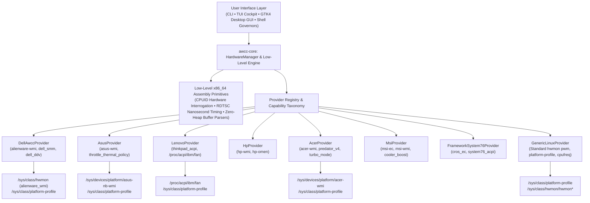

# AWCC Linux (`awcc-linux`)

Universal hardware performance orchestration, dynamic cooling fan control, platform profile governance, low-level assembly diagnostics, and truthful real-time telemetry suite for Linux.

Supports **Dell & Alienware**, **ASUS ROG/TUF**, **Lenovo ThinkPad/Legion**, **HP Omen/Victus**, **Acer Predator/Nitro**, **MSI Gaming**, **Framework**, **System76**, and standard Linux desktop motherboards.

---

## Universal Architecture Overview



---

## Key Features

### 1. Low-Level x86_64 Assembly Primitives (`crates/awcc-core/src/hw/`)
- **Direct CPUID Hardware Interrogation (`cpuid.rs`)**: Directly executes `__cpuid` assembly instructions to query processor signature, family, model, stepping, and full 48-byte hardware CPU Brand String (`13th Gen Intel(R) Core(TM) i7-13650HX`), eliminating reliance on `/proc/cpuinfo` parsing.
- **Hardware Thermal & Power Flags**: Interrogates Leaf `0x06` for Digital Thermal Sensor (DTS), Intel Turbo Boost, Hardware P-States (HWP / Intel Speed Shift), and Energy Performance Preference (EPP).
- **Cycle-Accurate RDTSC Timing (`rdtsc.rs`)**: Executes `_rdtsc` and `__rdtscp` with serialization barriers (`_mm_lfence`) to measure sub-microsecond latency of ACPI and sysfs read/write operations with nanosecond resolution.
- **Zero-Allocation Fast Buffer Parsers (`fast_parse.rs`)**: Branchless ASCII integer and float parsers (`parse_u32_ascii`, `parse_f32_ascii`) operating directly on raw byte slices to eliminate heap allocation during continuous telemetry polling.

### 2. Continuous Hardware Monitoring ("Tracking All")
- **Live Real-Time Telemetry Streaming**: `awccctl track`, `awccctl monitor`, or `awcc-monitor` continuously stream CPU load %, core frequencies, package power, GPU utilization, core/memory clocks, VRAM usage, GPU power draw, Motherboard VRM temp, Ambient air intake temp, RAM SODIMM temps, and dual high-pressure turbine RPMs.
- **Actuation with Live Monitoring**: Actuating modes (e.g. `awcc-quiet`, `awcc-balance`, `awcc-mode`) automatically transitions into real-time monitoring until interrupted (`Ctrl+C` / SIGINT). Pass `--once`, `--snapshot`, or `--no-monitor` for single-shot scripting.
- **Clean Signal Trapping**: Standardized signal handlers restore terminal cursor visibility (`\x1b[?25h\x1b[0m`) and clean up terminal state on `SIGINT`, `SIGTERM`, and `SIGHUP`.

### 3. Cinema-Grade TrueColor Terminal Cockpit (`bin/awcc-lux-dashboard.py`)
- **6 Calibrated Visual Themes**:
  1. `cryo` (Alienware Cryo-Tech Pro, Default)
  2. `cyberpunk` (Cyberpunk 2077 Night City)
  3. `darkcore` (Alienware Dark Core OLED)
  4. `solar` (Solar Flare Cockpit HUD)
  5. `matrix` (Matrix Emerald Phosphor)
  6. `vaporwave` (Vaporwave Sunset)
- **Live Interactive Theme Cycling**: Press `[C]` or `[T]` inside the cockpit to cycle themes dynamically without quitting; preferences persist in `~/.config/awcc/theme`.
- **Terminal Auto-Detection & Graceful Degradation**: Automatically detects terminal fidelity via `$TERM` and `COLORTERM`, seamlessly degrading from 24-bit TrueColor to ANSI 256-color or standard 16-color on virtual consoles (`/dev/tty1-6`).

### 4. Modern Desktop GUI (`bin/awcc-gui`)
- **Native GTK4 + Libadwaita Cockpit**: Modern desktop interface with live thermal progress meters, capability-gated turbine boost sliders, platform profile selectors, and diagnostic health status.
- **PolicyKit Elevation (`pkexec` / `sudo -n`)**: Multi-stage privilege escalation prompts the desktop PolicyKit authentication dialog (`io.github.monkey0_9.awcc.policy`) when actuating hardware settings without requiring insecure world-writable permissions.
- **Dual Turbine Telemetry**: Dynamically discovers and renders both CPU Fan (Fan 1) and GPU Fan (Fan 2) with real-time tachometer feedback.

### 5. Native Shell Auto-Completions & Unix Manual Pages
- **Full Shell Completions**: Comprehensive completion scripts for **Bash** (`completions/bash/awccctl`), **Zsh** (`completions/zsh/_awccctl`), and **Fish** (`completions/fish/awccctl.fish`) completing subcommands, profiles, fan actions, and flags dynamically.
- **Unix Manual Pages**: Formatted troff manual pages for `awccctl(1)`, `awcc-lux-dashboard(1)`, and `awcc-mode(1)`.

### 6. Autonomous Safety Daemon (`awccd`)
- Piecewise-linear thermal response curves, anti-hunt hysteresis damping (`saturating_sub(15)`), and emergency fail-safe reversion to BIOS control on fault.

---

## Security Model & Zero World-Writable Guarantee

- **Secure Root Controls (0644)**: System fan boost nodes (`fan[1-2]_boost`, `pwmX`) and platform profile switches are strictly restricted to root. World-writable permissions (`chmod 0666` or `0777`) are strictly forbidden across all scripts, specs, and daemons.
- **Unprivileged Telemetry Observation**: Unprivileged users can freely inspect real-time tachometer RPM, temperatures, clocks, power draw, and active profiles via `awccctl status`, `awccctl track`, `awccctl capabilities`, the desktop GUI, or the terminal dashboard.
- **Privileged Actuation**: Changing profiles or commanding fan boost offsets requires root mediation through PolicyKit (`pkexec`), `sudo`, or the systemd background daemon (`awccd.service`).

---

## Operational Modes Ladder

| Mode | Shortcut | Platform Profile | Fan Boost | RPM Ceiling | Description |
| :--- | :--- | :--- | :--- | :--- | :--- |
| **Battery Saver** | `awcc-battery` | `quiet` | `10/255` (~4%) | ~1,000 RPM | Silent whisper, restricts thermal headroom for maximum battery runtime |
| **Quiet** | `awcc-quiet` | `quiet` | `20/255` (~8%) | ~1,450 RPM | Low-noise acoustic silence for study and office environments |
| **Balance** | `awcc-balance` | `balanced` | `40/255` (~16%) | ~1,980 RPM | Daily productivity balance with moderate cooling |
| **Mid** | `awcc-mid` | `performance` | `65/255` (~25%) | ~3,100 RPM | Sustained compilation, light gaming, content creation |
| **High** | `awcc-high` | `performance` | `85/255` (~33%) | ~4,200 RPM | Heavy gaming and sustained computational workloads |
| **Ultra (G-Mode)**| `awcc-ultra` / `rhel-performance` | `performance` | `255/255` (100%) | ~4,800\(en5,029 RPM | True maximum fan speed and peak performance headroom |

---

## Quick Start & Usage

### 1. Build and Run CLI
```bash
# Build optimized release binaries
cargo build --release

# Inspect detected hardware capabilities and verification tier
target/release/awccctl capabilities

# Inspect full telemetry matrix snapshot
target/release/awccctl status

# Run comprehensive system diagnostics (includes CPUID & RDTSC assembly probes)
target/release/awccctl doctor
```

### 2. Continuous Hardware Monitoring ("Tracking All")
```bash
# Stream live metrics in real time (refresh every 1.0s, press Ctrl+C to stop)
awccctl track
# Or use the monitor alias:
awccctl monitor
# Or run the dedicated monitor script:
awcc-monitor
```

### 3. Launch Cybernetic Terminal Dashboard (TUI Cockpit)
```bash
# Interactive TrueColor cockpit (press [C] or [T] to switch themes live!)
python3 bin/awcc-lux-dashboard.py

# Launch directly with a specific color theme:
python3 bin/awcc-lux-dashboard.py --theme cyberpunk
python3 bin/awcc-lux-dashboard.py --theme solar
python3 bin/awcc-lux-dashboard.py --theme matrix

# Single snapshot check:
python3 bin/awcc-lux-dashboard.py --snapshot
```

### 4. Launch Modern Desktop GUI (GTK4 + Libadwaita)
```bash
bin/awcc-gui
```

### 5. Actuate Profiles with Live Monitoring
```bash
# Actuate Quiet mode and stream live telemetry until Ctrl+C:
awcc-quiet

# Actuate Ultra (G-Mode) with 255/255 fan boost:
awcc-ultra

# Single-shot execution without continuous streaming:
awcc-quiet --once
```

### 6. Emergency Recovery (Revert Fans to BIOS Control)
```bash
doctor-recovery
# Or via CLI:
awccctl fan release
```

---

## Multi-Distribution Installation

### Synchronize to User Environment
```bash
./bin/sync-local-bin.sh
```
Compiles release binaries and synchronizes `awccctl`, `awccd`, `awcc-gui`, `awcc-lux-dashboard.py`, `awcc-mode`, `awcc-monitor`, `awcc-track`, shell completions, and man pages to `~/.local/bin/` and `~/.local/share/`.

### System-Wide Installation Script
```bash
sudo ./bin/install-system.sh
```
Intelligently inspects `/etc/os-release` and host DMI hardware:
- Installs binaries to `/usr/local/bin/`.
- Installs PolicyKit action policy (`io.github.monkey0_9.awcc.policy`) to `/usr/share/polkit-1/actions/`.
- Installs shell completions for Bash, Zsh, and Fish to `/usr/share/`.
- Installs Unix manual pages to `/usr/share/man/man1/`.
- Installs XDG desktop entry (`awcc-gui.desktop`) and SVG application icon.
- Configures background thermal governor service (`systemd`, `openrc`, or `runit`).
- On Dell hardware, installs signed `alienware-wmi` module; on non-Dell systems, binds upstream Linux drivers.

### Clean Uninstaller Script
```bash
sudo ./bin/uninstall-system.sh
```
Cleanly reverts fans to firmware control, stops daemons, removes binaries, completions, man pages, desktop entries, and kernel modules.

### Distribution Packaging Specifications
- **Fedora / CentOS RPM**: `packaging/fedora/awcc-linux.spec`
- **openSUSE RPM**: `packaging/opensuse/awcc-linux.spec`
- **RHEL 10.2 / Enterprise Linux RPM**: `packaging/rhel/awcc-linux.spec`
- **Debian / Ubuntu**: `packaging/debian/control` and `packaging/debian/rules`
- **Arch Linux**: `packaging/arch/PKGBUILD`
- **NixOS Flake**: `packaging/nixos/flake.nix` and `packaging/nixos/default.nix`

---

## Hardware Verification Tiers & Documentation

Detailed hardware documentation is archived in `docs/`:
- [`docs/compatibility-matrix.md`](docs/compatibility-matrix.md): Complete list of Tier 1 through Tier 4 verified hardware models.
- [`docs/multi-vendor-guide.md`](docs/multi-vendor-guide.md): Architectural deep dive into capability negotiation across vendors.
- [`docs/hardware-telemetry-submission.md`](docs/hardware-telemetry-submission.md): Guide for submitting new hardware evidence to certify community models.
- [`docs/architecture.html`](docs/architecture.html): Interactive SVG architectural layout diagram.

---

## Hardware Game Shift Hotkey (F9)

To bind the Dell F9 Game Shift key in GNOME desktop environments:
```bash
./bin/setup-f9-keybind.sh
```
To cleanly remove the binding without affecting your other desktop shortcuts:
```bash
./bin/uninstall-f9-keybind.sh
```

---

## License & Third-Party Provenance

- **Kernel Module (`kernel/`)**: GNU General Public License v2.0 or later ([GPL-2.0-or-later](LICENSES/GPL-2.0.txt)), derived from upstream `alienware-wmi` patches by Kurt Borja and Mario Limonciello.
- **Userspace Rust Crates and Scripts (`crates/`, `bin/`)**: [MIT License](LICENSES/MIT.txt).
- Full file-by-file inventory is documented in [docs/provenance-and-licenses.md](docs/provenance-and-licenses.md).
