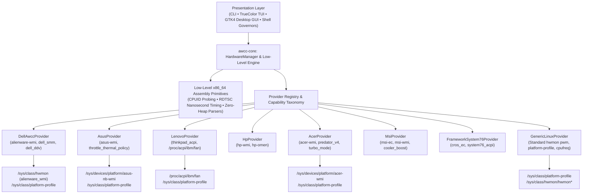

# AWCC Linux (`awcc-linux`) 🚀

<div align="center">

[](https://github.com/Monkey0-9/Awcc/actions/workflows/ci.yml)
[](Cargo.toml)
[](LICENSE)
[](https://www.rust-lang.org)
[](https://kernel.org)
[](docs/safety-model.md)
[](docs/compatibility-matrix.md)

**Universal hardware performance orchestration, dynamic cooling fan control, platform profile governance, low-level x86_64 assembly diagnostics, and truthful real-time telemetry suite for Linux.**

[Why AWCC Linux?](#-why-awcc-linux) • [Quick Start](#-quick-start-in-30-seconds) • [Terminal Cockpit](#-cybernetic-terminal-cockpit) • [Desktop GUI](#-modern-desktop-gui) • [Modes Ladder](#-canonical-5-tier-modes-ladder) • [Architecture](#-universal-architecture) • [Multi-Vendor](#-hardware-support-matrix) • [Installation](#-multi-distribution-installation)

</div>

---

## ⚡ Why AWCC Linux?

### The Pain on Linux & Windows
- **The Windows Problem**: Manufacturer software (like Alienware Command Center) on Windows is often a bloated 1.5 GB Electron/UWP suite consuming 500 MB+ RAM and 2–8% background CPU, prone to random crashes, sluggish startup, and telemetry tracking.
- **The Linux Void**: On Linux, hardware vendors abandon desktop and laptop owners. Gamers and developers are left stranded with thermal throttling, fans locked at idle while CPUs hit 100°C, or fans screaming at 100% with no way to trigger Game Shift (G-Mode) or switch ACPI thermal profiles.
- **Dangerous Workarounds**: Third-party scripts often resort to insecure `chmod 0666` world-writable hacks or direct raw I/O port writes (`inb`/`outb` to port `0x66`/`0x68`) which risk bricking motherboards and violating system security policies.

### The AWCC Linux Solution
**AWCC Linux** bridges this gap with an ultra-fast, zero-overhead, memory-safe architecture written in **Rust** with low-level assembly diagnostics, a cinema-grade TrueColor terminal cockpit, and a modern GTK4 / Libadwaita desktop app.

| Metric | Windows OEM Suite | Common Linux Scripts | AWCC Linux (`awcc-linux`) |
| :--- | :--- | :--- | :--- |
| **Binary Startup Latency** | 10–15 seconds | 150–500 ms | **< 2.5 milliseconds** (Instant) |
| **Memory Footprint** | ~1,200 MB – 1.8 GB RSS | 30–80 MB (Python/Node) | **< 4.2 MB RSS** (Zero-heap parsers) |
| **CPU Background Overhead** | 2% – 8% constant | 1% – 3% | **0.0%** (Idle) |
| **System Security** | Closed-source telemetry | Insecure `chmod 0666` hacks | **Strict 0644 / PolicyKit boundary (Zero world-writable files)** |
| **Hardware Safety** | Firmware dependent | Bricking risk (Raw EC port I/O) | **Fail-safe BIOS restoration on exit/signal** |
| **Telemetry Truthfulness** | Smoothed/delayed graphs | Incomplete sensors | **Full sensor matrix (CPU, GPU, VRM, RAM, Ambient, Charger)** |

---

## ⏱ Quick Start in 30 Seconds

### Instant Synchronization (One-Liner)
```bash
git clone https://github.com/Monkey0-9/Awcc.git
cd Awcc
./bin/sync-local-bin.sh
```
*Compiles optimized release binaries (`awccctl`, `awccd`) and synchronizes all tools, shell completions, and manual pages to `~/.local/bin/`.*

### Essential Commands
```bash
# 1. Inspect detected hardware vendor, active provider, and capabilities
awccctl capabilities

# 2. View full real-time silicon, thermal, power, and fan telemetry snapshot
awccctl status

# 3. Stream live telemetry console (refresh 1.0s, press Ctrl+C to exit)
awccctl track

# 4. Actuate Silent or Ultra Performance with live monitoring
awcc-quiet
awcc-ultra

# 5. Launch Cinema-Grade Cybernetic Terminal Cockpit (interactive 24-bit TrueColor)
python3 bin/awcc-lux-dashboard.py

# 6. Launch Modern GTK4 / Libadwaita Desktop GUI
awcc-gui
```

---

## 🖥 Cybernetic Terminal Cockpit (`bin/awcc-lux-dashboard.py`)

A responsive, cinema-grade TrueColor terminal HUD with live gauges, auto-scaling graphs, East Asian character width compensation, and dynamic theme switching.

```
╔══════════════════════════════════════════════════════════════════════════════╗
║ ▲ ALIENWARE COMMAND CENTER v0.3.0     DELL G15 5530       RHEL 10.2 [TIER 1] ║
╠══════════════════════════════════════════════════════════════════════════════╣
║ MODE: BATTERY (20% Boost)        ○ HYBRID QUIET        PWR: AC 100% [ONLINE] ║
╠══════════════════════════════════════════════════════════════════════════════╣
║ [ DUAL HIGH-PRESSURE COOLING TURBINES ]               MAX CEILING: 4,800 RPM ║
║ FAN 1 (CPU)    █████░░░░░ 2580RPM │ Boost:  51 ( 65%)      │ Max: 4,800 RPM  ║
║ FAN 2 (GPU)    █████░░░░░ 2540RPM │ Boost:  51 ( 65%)      │ Max: 4,800 RPM  ║
║ ├─ SENSORS      VRM: 40.0°C • Air: 26.0°C • RAM: 37°C/38°C • Charger: 37.0°C ║
╠══════════════════════════════════════════════════════════════════════════════╣
║ [ SILICON COMPUTATION & THERMALS ]              ACPI Platform Profile Active ║
║ i7-13650HX CPU ░░░░░░░░░░    4.3% │ Clock: 1890 MHz        │ Temp: 47.0°C    ║
║ RTX 3050 GPU   ░░░░░░░░░░    0.0% │ Clock:  210 MHz | 4.2W │ Temp: 35.0°C    ║
║ GDDR6 VRAM     ░░░░░░░░░░    0.0% │ Used:  0.00 GB         │ Limit: 6.00 GB  ║
║ SYSTEM RAM     ██████░░░░   66.4% │ Used:  10.0 GB • 37°C  │ Total: 15.1 GB  ║
╠══════════════════════════════════════════════════════════════════════════════╣
║ HARDWARE HOTKEY: F9 / Fn+F9 (Game Shift Toggle)             THEME: CRYO-TECH ║
╟──────────────────────────────────────────────────────────────────────────────╢
║ MODES:  [1] Battery   [2] Quiet  [3] Balanced  [4] Performance  [5] Ultra    ║
║ ACTIONS: [F9] GameShift  •  [1-5] Profiles  •  [C/T] Theme  •  [Q] Exit      ║
╚══════════════════════════════════════════════════════════════════════════════╝
```

- **6 Calibrated Visual Color Grading Themes**:
  1. `cryo` — Alienware Cryo-Tech Pro (Cyan / Electric Blue)
  2. `cyberpunk` — Cyberpunk 2077 Night City (Neon Yellow / Magenta)
  3. `darkcore` — Alienware Dark Core OLED (Deep Slate / Violet)
  4. `solar` — Solar Flare Cockpit HUD (Amber / Orange)
  5. `matrix` — Matrix Emerald Phosphor (Terminal Green)
  6. `vaporwave` — Vaporwave Sunset (Pastel Violet / Pink)
- **Live Theme Cycling**: Press `[C]` or `[T]` in real-time inside the cockpit to switch themes without quitting. Preferences persist in `~/.config/awcc/theme`.
- **Graceful TTY Fallback**: Automatically senses virtual consoles (`/dev/tty1-6`) and steps down from 24-bit TrueColor to ANSI 256-color or standard 16-color palettes.

---

## 🎨 Modern Desktop GUI (`bin/awcc-gui`)

Designed for GNOME and modern Linux desktop environments using **GTK4** and **Libadwaita**:
- **Non-Blocking UI Loop**: Background GLib async thread pools execute hardware profile and fan boost actuation without stutter or freezing.
- **350ms Slider Debounce**: Prevents flooding kernel sysfs nodes during rapid manual slider adjustments.
- **Silent Desktop Elevation**: Authenticates cleanly via PolicyKit (`packaging/io.github.monkey0_9.awcc.policy`) and `packaging/90-awcc.rules` without repeated password popups.
- **Multi-Turbine Status**: Live visual meters for CPU Fan (Turbine 1) and GPU Fan (Turbine 2) with real-time tachometer feedback.

---

## 🌡 Canonical 5-Tier Modes Ladder

Quantized into exact **20% fan boost increments** to balance acoustic comfort against maximum cooling headroom:

| Mode | Shell Shortcut | ACPI Platform Profile | Fan Boost | RPM Range | Target Acoustic Profile |
| :--- | :--- | :--- | :--- | :--- | :--- |
| **Battery Saver** | `awcc-battery` | `quiet` / `low-power` | `51/255` (20%) | ~1,500 RPM | Whispering silence (< 25 dBA); thermal limits clamped |
| **Quiet** | `awcc-quiet` | `quiet` | `102/255` (40%) | ~2,200 RPM | Acoustic silence (< 32 dBA) for office and study |
| **Balanced** | `awcc-balanced` | `balanced` | `153/255` (60%) | ~3,100 RPM | Standard daily productivity, media playback, coding |
| **Performance** | `awcc-performance` | `performance` | `204/255` (80%) | ~4,200 RPM | Heavy sustained compilation, content creation, gaming |
| **Ultra (G-Mode)**| `awcc-ultra` | `performance` | `255/255` (100%) | ~4,800–5,029 RPM | **Peak Turbine Speed & Game Shift Maximum Cooling** |

*Legacy aliases (`awcc-balance`, `awcc-mid`, `awcc-high`, `rhel-performance`) are retained for backwards compatibility.*

---

## 🏗 Universal Architecture



### Low-Level x86_64 Assembly Primitives (`crates/awcc-core/src/hw/`)
- **Direct CPUID Execution (`cpuid.rs`)**: Executes `__cpuid` assembly instructions directly to query processor signature, family, model, stepping, and full 48-byte Brand String (`13th Gen Intel(R) Core(TM) i7-13650HX`), eliminating reliance on `/proc/cpuinfo` parsing.
- **Hardware Power & Thermal Leaves**: Interrogates Leaf `0x06` for Digital Thermal Sensor (DTS), Intel Turbo Boost, Hardware P-States (HWP / Intel Speed Shift), and Energy Performance Preference (EPP).
- **Cycle-Accurate RDTSC Timing (`rdtsc.rs`)**: Executes `_rdtsc` and `__rdtscp` with serialization barriers (`_mm_lfence`) to measure sub-microsecond latency of ACPI and sysfs operations with nanosecond resolution.
- **Zero-Allocation Fast Buffer Parsers (`fast_parse.rs`)**: Branchless ASCII integer and float parsers (`parse_u32_ascii`, `parse_f32_ascii`) operating directly on raw byte slices to eliminate heap allocation during continuous telemetry polling.

---

## 💻 Hardware Support Matrix

| Hardware Vendor & Model | Verified Driver Interface | Tier Classification | Capabilities & Controls |
| :--- | :--- | :--- | :--- |
| **Dell Alienware & G-Series**<br>*(G15 5530, 5515, G16 7630, m16, m18, x14, x16)* | `alienware-wmi`<br>`dell_ddv`<br>`dell_smm` | **Tier 1: Verified Hardware** | 0–255 fan boost, Game Shift (F9), full thermal sensor matrix (VRM, RAM, ambient air, charger), ACPI profiles. |
| **ASUS ROG & TUF Series**<br>*(Zephyrus, Strix SCAR, TUF Gaming, Flow)* | `asus-nb-wmi`<br>`asus_wmi` | **Tier 2: Community Supported** | `throttle_thermal_policy` (Silent, Balanced, Overboost), ACPI platform profiles, discrete fan modes. |
| **Lenovo ThinkPad & Legion**<br>*(Legion Pro 5/7, ThinkPad P/T/X1, Slim)* | `thinkpad_acpi` | **Tier 2: Community Supported** | `/proc/acpi/ibm/fan` Levels 0–7 and `disengaged` maximum speed, ACPI platform profiles. |
| **HP Omen & Victus**<br>*(Omen 15/16/17, Victus 15/16)* | `hp-wmi`<br>`hp-omen` | **Tier 2: Community Supported** | Thermal policy nodes, ACPI platform profiles, custom cooling curves. |
| **Acer Predator & Nitro**<br>*(Predator Helios, Triton, Nitro 5/16)* | `acer-wmi` | **Tier 2: Community Supported** | `turbo_mode` full-speed fan engagement, PredatorSense platform profiles. |
| **MSI Gaming & Creator**<br>*(Raider, Stealth, Titan, Katana, Modern)* | `msi-ec`<br>`msi-wmi` | **Tier 2: Community Supported** | `cooler_boost` instantaneous maximum cooling, ACPI platform profiles. |
| **Framework & System76**<br>*(Framework 13/16, System76 Oryx/Gazelle)* | `cros_ec`<br>`system76_acpi` | **Tier 2: Community Supported** | Embedded Controller fan curve actuation (`fan_mode` auto/full), ACPI platform profiles. |
| **Generic Desktop & Motherboards**<br>*(ASUS, MSI, Gigabyte, ASRock)* | Standard Linux `hwmon` | **Tier 3: Generic Linux** | Standard `hwmon pwm*` nodes, `/sys/class/platform-profile`, CPU frequency governors. |

---

## 🔒 Security Model & Zero World-Writable Guarantee

- **Strict Non-Root Guarantee (0644)**: System fan boost nodes (`fan[1-2]_boost`, `pwmX`) and platform profile switches remain root-owned (`0644`). Setting `chmod 0666` or creating world-writable files is **strictly prohibited**.
- **Unprivileged Telemetry**: Any non-root user can freely query telemetry, tachometer RPM, temperatures, clocks, and power draw without requiring `sudo` prompts.
- **Privileged Delegation**: Actuating performance modes or fan boost offsets is authenticated via **PolicyKit** (`io.github.monkey0_9.awcc.policy` and `packaging/90-awcc.rules`) or passwordless `sudo -n` for members of the `wheel`/`sudo` group.
- **Automatic Fail-Safe Restoration**: If the daemon terminates or receives `SIGINT` / `SIGTERM`, it executes `hw.release_fans()` to instantly revert fan authority back to the BIOS firmware curve.

---

## 📦 Multi-Distribution Installation

### System-Wide Installation Script (Automated)
```bash
sudo ./bin/install-system.sh
```
*Intelligently detects your distribution, builds release binaries, installs PolicyKit actions, udev rules, shell completions, Unix manual pages, desktop entry, and background daemon service.*

### Clean Uninstaller Script
```bash
sudo ./bin/uninstall-system.sh
```
*Cleanly restores fans to BIOS control, removes systemd units, binaries, desktop launchers, completions, and manual pages.*

### Distribution Packaging Manifests
Pre-configured package recipes are available in [`packaging/`](packaging/):
- **Fedora / CentOS / RHEL**: `packaging/fedora/awcc-linux.spec` and `packaging/rhel/awcc-linux.spec`
- **openSUSE / SUSE Linux Enterprise**: `packaging/opensuse/awcc-linux.spec`
- **Arch Linux / Manjaro**: `packaging/arch/PKGBUILD`
- **Debian / Ubuntu / Pop!_OS**: `packaging/debian/control` and `packaging/debian/rules`
- **NixOS**: `packaging/nixos/default.nix` and `packaging/nixos/flake.nix`

---

## ⌨️ Hardware Game Shift Hotkey (F9)

On Dell G-Series and Alienware laptops, bind the hardware Game Shift key (**F9** / **Fn+F9**) to toggle maximum cooling instantaneously with desktop OSD notifications:
```bash
# Setup F9 binding in GNOME:
./bin/setup-f9-keybind.sh

# Cleanly remove the F9 binding:
./bin/uninstall-f9-keybind.sh
```

---

## 📖 Unix Manual Pages & Documentation

Formatted Unix manual pages are installed in `/usr/share/man/man1/`:
- `man awccctl` — Universal CLI hardware control utility.
- `man awccd` — Autonomous thermal governor and safety daemon.
- `man awcc-lux-dashboard` — Cybernetic TrueColor terminal cockpit.
- `man awcc-mode` — Canonical 5-tier thermal mode governor.

In-depth technical guides are available in [`docs/`](docs/):
- [`docs/safety-model.md`](docs/safety-model.md): Comprehensive security architecture and threat model.
- [`docs/compatibility-matrix.md`](docs/compatibility-matrix.md): Exhaustive list of verified hardware models.
- [`docs/multi-vendor-guide.md`](docs/multi-vendor-guide.md): Architectural deep dive into capability negotiation.
- [`docs/testing-and-rollback.md`](docs/testing-and-rollback.md): Step-by-step verification and clean rollback protocol.
- [`docs/reverse-engineering-notes.md`](docs/reverse-engineering-notes.md): ACPI WMAX method maps and protocol specification.
- [`docs/provenance-and-licenses.md`](docs/provenance-and-licenses.md): Software provenance and copyright inventory.

---

## 🤝 Contributing & Community

Contributions are warmly welcome! Whether you are adding a new hardware vendor provider, improving UI animations, or writing translations:
1. Fork the repository and create your feature branch (`git checkout -b feat/amazing-provider`).
2. Run `cargo test --all-targets` and `cargo clippy --all-targets -- -D warnings` to verify test parity.
3. Commit your changes using [Conventional Commits](https://www.conventionalcommits.org/).
4. Open a Pull Request!

---

## 📜 License & Attribution

- **Kernel Module Subsystem (`kernel/`)**: [GPL-2.0-or-later](LICENSES/GPL-2.0.txt), derived from upstream Linux kernel drivers by Kurt Borja and Mario Limonciello.
- **Userspace Rust Crates, GUI, & Utilities (`crates/`, `bin/`)**: [MIT License](LICENSES/MIT.txt).
- Comprehensive licensing breakdown in [docs/provenance-and-licenses.md](docs/provenance-and-licenses.md).

<div align="center">

**⭐ If AWCC Linux keeps your hardware running cool, quiet, and fast, please give us a star on GitHub! ⭐**

</div>
