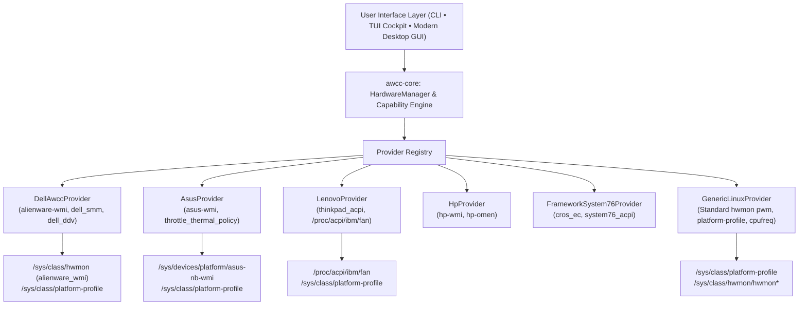

# AWCC Linux (`awcc-linux`)

Universal hardware performance orchestration, dynamic fan control, platform profile governance, and real-time telemetry suite for Linux.

Supports **Dell & Alienware**, **ASUS ROG/TUF**, **Lenovo ThinkPad/Legion**, **HP Omen/Victus**, **Framework**, **System76**, and standard Linux desktop motherboards.

---

## Universal Architecture Overview



---

## Key Features

- **Multi-Vendor Capability Discovery (`awccctl capabilities`)**: Evaluates host hardware and negotiates supported capabilities (`FanControlCapability`, `PlatformProfileCapability`, `VerificationTier`) across vendors without crashing.
- **Modern Desktop GUI (`bin/awcc-gui`)**: Native GTK4 + Libadwaita hardware cockpit with live thermal progress meters, capability-gated fan boost sliders, platform profile selectors, and diagnostic health status.
- **Cybernetic Terminal Cockpit (`bin/awcc-lux-dashboard.py`)**: Full-terminal ANSI cockpit auto-scaling from 36 to 240+ columns with event-driven non-blocking input (<1ms key response) and real-time tachometer curves.
- **Autonomous Thermal Daemon (`awccd`)**: Background safety daemon featuring piecewise-linear fan ramps, anti-hunt hysteresis damping (`saturating_sub(15)`), and emergency fail-safe reversion to BIOS control.
- **Zero World-Writable Security Model**: Fan boost controls and platform profiles remain root-owned (`0644`). Unprivileged users read telemetry safely without sudo; privileged actuation is gated by polkit/sudo.
- **Emergency Hardware Recovery (`bin/doctor-recovery.sh`)**: One-command disaster recovery tool to reset all fan overrides to firmware control, restore balanced profile, and clear lock files.
- **Multi-Distribution Packaging**: Native packaging specs for Fedora, openSUSE, Debian/Ubuntu, Arch Linux, and NixOS Flake, with init service support for Systemd, OpenRC, and Runit.

---

## Security Model & Privilege Boundary

- **Secure Root Controls (0644)**: System fan boost nodes (`fan[1-2]_boost`, `pwmX`) and platform profile switches are restricted to root. World-writable permissions (`chmod 0666` or `0777`) are strictly forbidden across all scripts, specs, and daemons.
- **Unprivileged Telemetry**: Unprivileged users can freely inspect real-time tachometer RPM, temperatures, and current profiles via `awccctl status`, `awccctl detect`, `awccctl capabilities`, the desktop GUI, or the terminal dashboard.
- **Privileged Actuation**: Changing profiles or commanding fan boosts requires `sudo` or the systemd background daemon (`awccd.service`). For convenience with desktop hotkeys (such as F9), an optional `/etc/sudoers.d/awcc-linux` rule permits wheel users to run `awccctl` fan and profile commands without a password prompt.

---

## Quick Start & Verification

### 1. Build and Run CLI
```bash
cargo build --release
target/release/awccctl detect
target/release/awccctl capabilities
target/release/awccctl status
```

### 2. Launch Desktop GUI (GTK4 + Libadwaita)
```bash
bin/awcc-gui
```

### 3. Launch Cybernetic Terminal Dashboard (TUI Cockpit)
```bash
python3 bin/awcc-lux-dashboard.py
# Or snapshot one-liner:
python3 bin/awcc-lux-dashboard.py --snapshot
```

### 4. Run System Diagnostics
```bash
awccctl doctor
```

### 5. Actuate True Maximum Performance & Fans (Tier 1/2)
```bash
sudo awccctl fan max
# Or via shortcut:
sudo awcc-ultra
```

### 6. Emergency Recovery (Revert Fans to BIOS Control)
```bash
sudo doctor-recovery
# Or via CLI:
sudo awccctl fan release
```

---

## Operational Modes Ladder

| Mode | Shortcut | Platform Profile | Fan Boost | RPM Ceiling | Description |
| :--- | :--- | :--- | :--- | :--- | :--- |
| **Battery Saver** | `awcc-battery` | `quiet` | `10/255` (~4%) | ~1,000 RPM | Silent whisper, restricts thermal headroom for maximum battery runtime |
| **Quiet** | `awcc-quiet` | `quiet` | `20/255` (~8%) | ~1,450 RPM | Low-noise acoustic silence for study and office environments |
| **Balance** | `awcc-balance` | `balanced` | `40/255` (~16%) | ~1,980 RPM | Daily productivity balance with moderate cooling |
| **Mid** | `awcc-mid` | `performance` | `65/255` (~25%) | ~3,100 RPM | Sustained compilation, light gaming, content creation |
| **High** | `awcc-high` | `performance` | `85/255` (~33%) | ~4,200 RPM | Heavy gaming and sustained computational workloads |
| **Ultra (G-Mode)**| `awcc-ultra` / `rhel-performance` | `performance` | `255/255` (100%) | ~4,800 RPM | True maximum fan speed and peak performance headroom |

---

## Multi-Distribution Installation

### Universal Installer Script
```bash
sudo ./bin/install-system.sh
```
Intelligently inspects `/etc/os-release` and DMI hardware:
- Installs binaries to `/usr/local/bin/` (`awccctl`, `awccd`, `awcc-gui`, `awcc-lux-dashboard.py`, `awcc-mode`, `doctor-recovery`).
- Installs XDG desktop entry (`awcc-gui.desktop`) and application icon (`awcc-gui.svg`).
- Configures system service (`systemd`, `openrc`, or `runit`).
- On Dell systems, compiles and registers signed `alienware-wmi` module; on non-Dell systems, binds native upstream drivers.

### Clean Uninstaller Script
```bash
sudo ./bin/uninstall-system.sh
```
Cleanly reverts all fans to firmware control, stops daemons, removes binaries, desktop entries, icons, and kernel module extras.

### Distribution Packaging Files
- **Fedora RPM**: `packaging/fedora/awcc-linux.spec`
- **openSUSE RPM**: `packaging/opensuse/awcc-linux.spec`
- **RHEL 10.2 / Enterprise Linux**: `packaging/rhel/awcc-linux.spec`
- **Debian / Ubuntu**: `packaging/debian/control` and `packaging/debian/rules`
- **Arch Linux**: `packaging/arch/PKGBUILD`
- **NixOS Flake**: `packaging/nixos/flake.nix` and `packaging/nixos/default.nix`

---

## Hardware Verification Tiers & Documentation

Detailed hardware documentation is archived in `docs/`:
- [`docs/compatibility-matrix.md`](docs/compatibility-matrix.md): Complete list of Tier 1 through Tier 4 verified hardware models.
- [`docs/multi-vendor-guide.md`](docs/multi-vendor-guide.md): Architectural deep dive into capability negotiation across vendors.
- [`docs/hardware-telemetry-submission.md`](docs/hardware-telemetry-submission.md): Guide for submitting new hardware evidence to certify community models.

---

## Hardware Game Shift Hotkey (F9)

To bind the Dell F9 Game Shift key in GNOME desktop environments:
```bash
./bin/setup-f9-keybind.sh
```
To cleanly remove the binding without affecting your other desktop shortcuts:
```bash
./bin/uninstall-f9-keybind.sh
```

---

## License & Third-Party Provenance
- **Kernel Module (`kernel/`)**: GNU General Public License v2.0 or later ([GPL-2.0-or-later](LICENSES/GPL-2.0.txt)), derived from upstream `alienware-wmi` patches by Kurt Borja and Mario Limonciello.
- **Userspace Rust Crates and Scripts (`crates/`, `bin/`)**: [MIT License](LICENSES/MIT.txt).
- Full file-by-file inventory is documented in [docs/provenance-and-licenses.md](docs/provenance-and-licenses.md).
