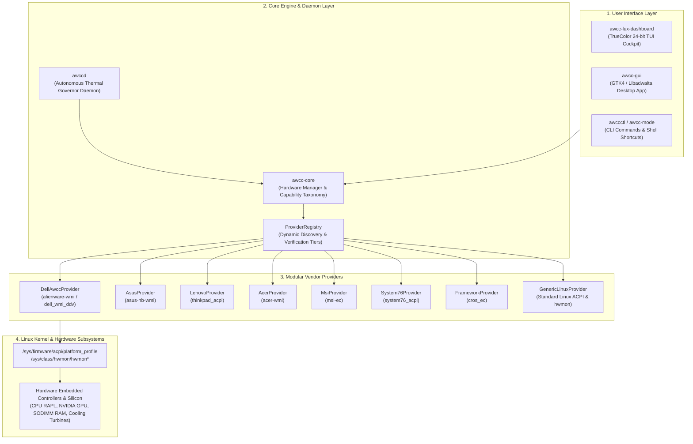

# AWCC Linux: Universal Architecture Specification

Interactive Visual Diagram: [docs/architecture.html](architecture.html) (rendered via Archify)

---

## 1. System Overview

AWCC Linux is an enterprise-grade, cross-distribution hardware performance and thermal control ecosystem. It provides unified telemetry, autonomous thermal governance, and platform profile management across multiple hardware manufacturers:
- **Dell & Alienware**: Direct `alienware-wmi` overboost control, `dell_wmi_ddv` reverse-engineered thermal data vault, and `dell_smm_hwmon`.
- **ASUS (ROG & TUF)**: `asus-nb-wmi` via `throttle_thermal_policy` (Silent, Overboost) and ACPI platform profiles.
- **Lenovo (ThinkPad & Legion)**: `thinkpad_acpi` via `/proc/acpi/ibm/fan` (Levels 0-7, `disengaged` maximum speed) and ACPI platform profiles.
- **HP (OMEN & Victus)**: `hp-wmi` thermal governor nodes and ACPI platform profiles.
- **Acer (Predator & Nitro)**: `acer-wmi` via `turbo_mode` and PredatorSense profiles.
- **MSI (Gaming & Creator)**: `msi-ec` / `msi-wmi` via `cooler_boost` full-speed fan actuation.
- **System76 (Oryx, Gazelle)**: `system76_acpi` via `fan_mode` (auto/full) and ACPI profiles.
- **Framework (13 & 16)**: `cros_ec` ChromeOS embedded controller and ACPI platform profiles.
- **Generic Linux Desktop PCs**: Standard `/sys/firmware/acpi/platform_profile` (Linux 5.12+) and standard `/sys/class/hwmon` PWM controls.

---

## 2. Layered Architecture

---

## 3. Reverse-Engineered Dell WMAX & DDV Sensor Pipeline

The telemetry engine reads all 7 hardware sensors exposed by Dell's Data Vault ACPI driver (`dell_wmi_ddv`) and fallback `dell_smm`:

| Sensor ID | Label | Hardware Meaning | Target Field in Telemetry |
| :--- | :--- | :--- | :--- |
| `temp1` | CPU | CPU Package Temperature | `thermals.cpu_pkg_temp` |
| `temp2` | Unknown | Motherboard Power Plane / VRM | `thermals.vrm_temp` |
| `temp3` | Unknown | Chassis Ambient Air Intake | `thermals.ambient_temp` |
| `temp4` | Video | GPU Core Thermal Sensor | `thermals.gpu_temp` (fallback) |
| `temp5` | SODIMM | RAM Module / Slot 1 Temp | `thermals.ram_temp` |
| `temp6` | SODIMM 2 | RAM Module / Slot 2 Temp | `thermals.ram_dimm2_temp` |
| `temp7` | Charger | Power Delivery / Charger VRM | `thermals.charger_temp` |

---

## 4. Operational & Security Contract

1. **Non-Root Execution**: `awccctl status`, `awccctl track`, `awcc-lux-dashboard.py`, and `awcc-gui` run entirely unprivileged (UID 1000).
2. **Strict Sysfs Mode (0644)**: Sysfs nodes remain `0644` with root ownership. World-writable permissions (`0666`, `0777`) are prohibited.
3. **Privileged Escalation Boundary**: Hardware writes (changing platform profile or writing fan boost) are performed through `awccd` or passwordless sudoers rules (`/etc/sudoers.d/awcc-linux`) scoped to `awcc-mode` and `awccctl`.
4. **Hysteresis Damping**: The `awccd` daemon prevents rapid turbine cycling by enforcing an anti-hunt damping delay of 3–5 seconds on down-ramps while maintaining immediate (<100ms) up-ramp actuation during thermal spikes.
