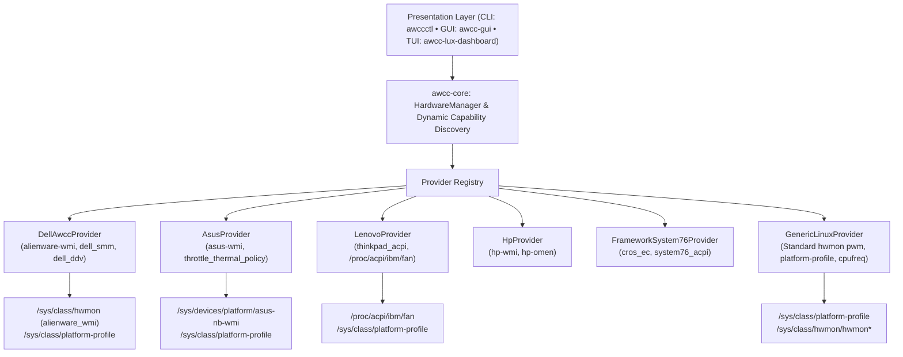

# Universal Linux Hardware Performance & Multi-Vendor Control Guide

The AWCC Linux platform provides an enterprise-grade, upstream-first hardware performance and thermal control engine for Linux systems. While initially developed for Dell G-Series and Alienware laptops, AWCC Linux features a modular capability discovery architecture supporting Dell, Alienware, ASUS, Lenovo, HP, Framework, System76, and custom desktop hardware.

---

## Architecture Overview



---

## Dynamic Capability Taxonomy

Rather than assuming all hardware has manual fan boost or Game Shift, `awcc-core` evaluates the system and compiles a `HardwareCapabilities` contract:

1. **`HardwareVendor` & `ChassisType`:**
   Parsed from DMI tables (`sys_vendor`, `product_name`, `chassis_type`). Supports `Dell`, `Alienware`, `Asus`, `Lenovo`, `Hp`, `Acer`, `Msi`, `Framework`, `System76`, `GenericPc`.

2. **`VerificationTier`:**
   - **Tier 1 (Physically Verified):** Tested on physical hardware by maintainers.
   - **Tier 2 (Community Supported):** Tested with upstream driver support.
   - **Tier 3 (Generic Linux Fallback):** Standard Linux hwmon and ACPI platform profile.
   - **Tier 4 (Unsupported):** Proprietary locked hardware without kernel interfaces.

3. **`FanControlCapability`:**
   - `BoostOffset { max_boost: 255 }`: Dell/Alienware 0-255 boost ladder above firmware base speed.
   - `StandardPwm { min: 0, max: 255 }`: Standard Linux desktop motherboard PWM controls (`pwm1..N`).
   - `DiscreteLevels { levels: [...] }`: ThinkPad discrete steps (0-7, auto, disengaged) or ASUS thermal policy modes (0=Default, 1=Overboost, 2=Silent).
   - `None`: Hardware where fan control is handled autonomously by embedded firmware and manual overrides are not exposed.

4. **`PlatformProfileCapability`:**
   Discovers `/sys/class/platform-profile/platform-profile-*` (Kernel 6.12+) and firmware ACPI nodes. Exposes available profiles (`quiet`, `balanced`, `performance`, `custom`).

---

## Multi-Vendor CLI Usage

### Inspecting Hardware Capabilities
```bash
awccctl capabilities
```
Produces a detailed hardware capability report:
```text
=== Universal Linux Hardware Capabilities ===
  DMI Vendor:           ASUSTeK COMPUTER INC.
  DMI Product:          ROG Zephyrus G14
  Chassis Type:         Laptop
  Verification Tier:    Tier 2: Community Supported Hardware
  Active Provider:      asus_wmi
  Fan Control:          Discrete Levels [0 (Default), 1 (Overboost), 2 (Silent)]
  Platform Profile:     Supported (Provider: asus-wmi, Current: balanced, Available: [quiet, balanced, performance])
  Game Shift (G-Mode):  Not Available on this platform
  GPU Telemetry:        Available (Discrete GPU sensors detected)
  Secure Boot Lockdown: Active (Kernel lockdown enforced)
```

JSON output for scripting:
```bash
awccctl capabilities --json
```

### Checking System Telemetry
```bash
awccctl status
```
Displays temperatures, tachometers, and active platform profiles across all detected sensors.

### Platform Profiles
```bash
awccctl profile performance
awccctl profile balanced
awccctl profile quiet
```

### Fan Control with Safe Degradation
On systems supporting manual fan control:
```bash
# Request max fan boost
awccctl fan max

# Revert to automatic firmware control
awccctl fan release
```
On systems where manual fan overrides are unsupported (Tier 3/4):
```text
[-] Error: Manual fan control is not supported on this hardware (Vendor: Unknown OEM, Tier: Tier 3: Generic Linux Fallback).
    Automatic firmware thermal management is active.
    Use 'awccctl profile <name>' to adjust thermal/power balance.
```

---

## Desktop GUI (`awcc-gui`)

The modern desktop GUI (`bin/awcc-gui`) automatically adapts to the host machine:
- Real-time gauge progress bars for CPU and GPU temperatures.
- Platform profile selector buttons (`Quiet`, `Balanced`, `Performance`, `Ultra`).
- Capability-gated fan controls: fan boost slider and "Max Fans" buttons are enabled only when `FanControlCapability` allows manual overrides.
- Diagnostics section displaying the active provider, verification tier, and Secure Boot status.

---

## Emergency Recovery Tool (`doctor-recovery`)

If fan controls ever become locked or an external utility leaves fans at full speed:
```bash
doctor-recovery
```
This tool:
1. Reverts fans to firmware control across all providers (Dell boost=0, ThinkPad level=auto, ASUS policy=0, Linux PWM mode=2).
2. Sets the platform profile back to `balanced`.
3. Purges stale lock and state files (`/tmp/.awcc_gmode_state`, `/run/awccd.pid`).
4. Verifies safe tachometer deceleration.
