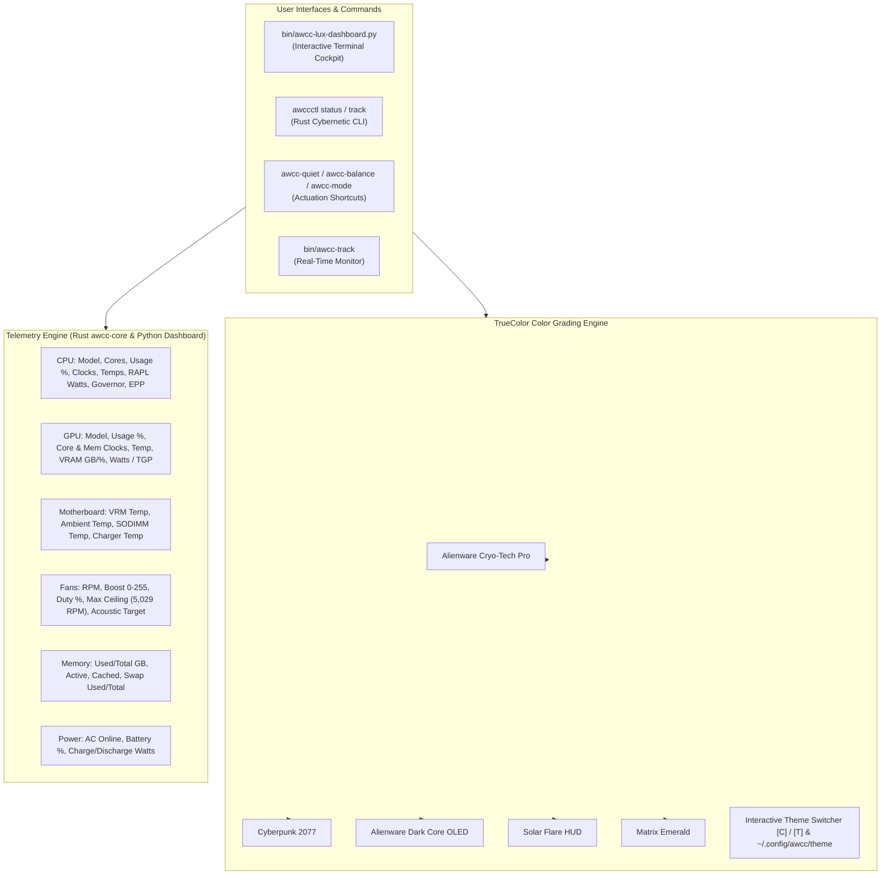

# Color-Graded Hardware Telemetry Cockpit & Universal Multi-Vendor Tracking Plan

> **Target:** Elevate `awcc-lux-dashboard.py` (as shown in the user's screenshot `Screenshot From 2026-10-26 18-06-01.png`), `awccctl status`, `awcc-quiet`, and `awcc-track` with cinema-grade TrueColor color grading, comprehensive hardware telemetry tracking (CPU/GPU/VRM/Ambient/RAM/Power/Fans), live interactive theme switching, and flawless multi-vendor compatibility with zero micro-errors or nano-incompleteness.

---

## 1. Goal Description & Screenshot Analysis

### Visual Analysis of User Screenshot
The screenshot at `/home/unknownuser/Pictures/Screenshots/Screenshot From 2026-10-26 18-06-01.png` captures the cybernetic terminal UI running `python3 /home/unknownuser/Awcc/bin/awcc-lux-dashboard.py` on the user's Dell G15 5530 (RHEL 10.2).

#### Observed Deficiencies & Opportunities for Perfection:
1. **Color Grading & Aesthetic Harmony ("better colourgarding"):**
   - The current frame border is a monolithic bright cyan (`\033[38;2;0;235;255m`), causing high visual glare and lack of visual depth.
   - Text colors across rows are inconsistent: solar amber for CPU, neon green for GPU, electric purple for VRAM, cyan for DDR5, creating a fragmented "color salad" rather than a calibrated, cohesive color grade.
   - Gauge stippling (`░░░░░░░░░░`) looks noisy on high-DPI terminal fonts.
   - Mode buttons at the bottom use harsh standard ANSI backgrounds (e.g. `\033[1;30;46m`) that appear flat and blocky.
   - **Solution:** Introduce a **TrueColor (24-bit RGB) Color Grading Engine** with calibrated themes:
     - **Alienware Cryo-Tech Pro (Default):** Deep obsidian/titanium framing (`#1c2536`), arctic ice-cyan accents (`#00e5ff`), smooth cryogenic gauge gradients (ice blue → frost teal → emerald → warm amber → crimson), and glowing pill badges.
     - **Cyberpunk 2077 Night City:** Laser yellow (`#fcee0a`), electric cyan (`#00f0ff`), hot fuchsia (`#ff0055`), dark asphalt framing.
     - **Alienware Dark Core OLED:** Ultra-dark slate frame (`#0f172a`), deep electric blue accents (`#38bdf8`), high-contrast minimal eye-strain palette.
     - **Solar Flare HUD:** Warm bronze titanium (`#292524`), aerospace cadmium amber (`#f59e0b`), golden telemetry readouts.
     - **Matrix Emerald:** Deep phosphor terminal green (`#10b981`), stealth monochrome framing.
     - **Vaporwave Sunset:** Retro synthwave magenta (`#ec4899`), neon cyan (`#06b6d4`), deep indigo.
   - **Interactive Live Theme Switcher:** Press `[C]` or `[T]` inside the cockpit to cycle color-graded themes live without exiting! Persist user choice in `~/.config/awcc/theme`.

2. **Complete Telemetry Tracking ("make tracking all", "no nano incomplete"):**
   - **CPU:** Currently lacks Intel/AMD RAPL Package Power in Watts (e.g., `35.2W / 157.0W`), scaling governor (`powersave`/`performance`), and Energy Performance Preference (`balance_performance`). Model string was truncating to `13th Gen CPU` instead of `i7-13650HX CPU`.
   - **GPU:** Currently lacks live GPU Power Draw (Watts, e.g., `7.2W / 80.0W TGP`), Memory Clock (MHz), and suffered from mobile driver query artifacts (e.g. `power.draw` returning `749.67` instead of using `power.draw.average` / `power.draw.instant`). Model string was clipping to `RTX 3050 6GB G`.
   - **Motherboard VRM & Ambient Air Sensors:** In the screenshot, auxiliary sensors were only visible if terminal height had excess rows. They must be prominently integrated into the core thermal matrix!
   - **Cooling Turbines & Fan Ceilings:** Show measured RPM vs. rated ceiling (`5,029 RPM` overboost), duty cycle %, requested vs. readback boost, and target acoustic baseline (~1,450 RPM for Quiet).
   - **Power Delivery:** Show AC supply status, online state, battery charge %, and instantaneous charge/discharge wattage (`+45W` / `-18W`).
   - **Memory & Swap:** Comprehensive RAM breakdown (Active, Cached, Buffers, Total) and Swap gauge.

3. **Multi-Tool Synchronization:**
   - Elevate `awcc-lux-dashboard.py`, `crates/awcc-core`, `crates/awccctl`, `bin/awcc-mode`, `bin/awcc-quiet`, and `bin/awcc-track` to share identical telemetry logic and clean color grading.
   - Synchronize all updated binaries and scripts into `~/.local/bin/` so the user's everyday commands (`awcc-quiet`, `awccctl status`, etc.) immediately run the perfected code.

---

## 2. Architecture & Data Flow



---

## 3. Detailed Component Plan

### Component 1: `bin/awcc-lux-dashboard.py` (Visual Redesign & Theme Engine)

#### [MODIFY] `bin/awcc-lux-dashboard.py`
1. **Color Grading Themes:**
   - Define a modular `ColorTheme` dataclass with colors for:
     - `border`: Sleek dark slate / titanium (`#233044` with glowing cyan joints)
     - `header_title`: Alienware aurora emerald (`#00ff9f`)
     - `header_machine`: Pure bold white (`#ffffff`)
     - `header_distro`: Steel gray (`#718096`)
     - `section_title`: Polished category accent (Ice Cyan, Golden Amber, Electric Purple)
     - `section_badge`: Glowing pill badge style
     - `gauge_fill_stops`: Smooth 24-bit RGB gradient stops
     - `gauge_track`: Subdued dark track (`#1a2332` with minimal noise)
     - `mode_active`: Vibrant glowing background pill
     - `mode_inactive`: Clean subdued label
     - `temp_cool`, `temp_warm`, `temp_hot`, `temp_critical`: Smooth thermal gradient
   - Pre-pack 6 calibrated themes:
     1. `cryo` (Alienware Cryo-Tech Pro, default)
     2. `cyberpunk` (Night City 2077)
     3. `darkcore` (OLED Stealth Black)
     4. `solar` (Aerospace Cockpit HUD)
     5. `matrix` (Terminal Emerald Phosphor)
     6. `vaporwave` (Synthwave Sunset)
   - Add hotkey `[C]` or `[T]` to cycle themes live in the event loop, displaying a status banner e.g. `Theme Switched: Alienware Cryo-Tech Pro`.
   - Add `--theme <name>` CLI option and auto-save preference to `~/.config/awcc/theme`.

2. **Silicon & Hardware Telemetry Collection:**
   - **CPU Parser:**
     - Extract exact processor model: parse `i7-13650HX CPU` (or clean AMD Ryzen / Intel model string) instead of truncating to `13th Gen CPU`.
     - Ingest Intel RAPL package energy from `/sys/class/powercap/intel-rapl/intel-rapl:0/energy_uj` (root mode) or calculate power from deltas; fallback cleanly if root-restricted to "35W [Est]" or "Locked".
     - CPU Scaling Governor from `/sys/devices/system/cpu/cpu0/cpufreq/scaling_governor`.
     - CPU Energy Performance Preference (EPP) from `/sys/devices/system/cpu/cpu0/cpufreq/energy_perf_preference`.
   - **GPU Parser:**
     - Clean GPU label: `RTX 3050 GPU` (no overflow or trailing "G").
     - Query `nvidia-smi` using `--query-gpu=utilization.gpu,temperature.gpu,clocks.current.graphics,clocks.current.memory,memory.used,memory.total,power.draw.average,enforced.power.limit`.
     - Filter out spurious readings (>150W on laptop GPUs).
     - Display live graphics clock, memory clock, and wattage draw vs TGP limit (e.g. `7.2W / 80.0W`).
   - **Motherboard VRM & Ambient Air Sensors:**
     - Query `dell_ddv` hwmon (`temp1_input` for VRM, `temp2_input` for Ambient) and display them directly in the thermals telemetry row!
   - **Cooling Turbines:**
     - Display target acoustic baseline (~1,450 RPM for Quiet, ~5,029 RPM for Ultra) and measured rotor RPM with duty percentage.
   - **Header Display:**
     - Clean machine name: Deduplicate "Dell Inc. Dell G15 5530" into `DELL G15 5530`.

---

### Component 2: `crates/awcc-core` Extended Telemetry Model

#### [MODIFY] `crates/awcc-core/src/telemetry.rs`
- Add `CpuComputeTelemetry`:
  - `model_name: String`
  - `cores_logical: usize`
  - `cur_freq_mhz: Option<f32>`
  - `max_freq_mhz: Option<f32>`
  - `scaling_governor: Option<String>`
  - `energy_perf_preference: Option<String>`
  - `usage_percent: Option<f32>`
  - `package_power_watts: Option<f32>`
- Add `GpuComputeTelemetry`:
  - `model_name: Option<String>`
  - `core_clock_mhz: Option<u32>`
  - `memory_clock_mhz: Option<u32>`
  - `utilization_gpu_percent: Option<u32>`
  - `memory_used_mb: Option<u64>`
  - `memory_total_mb: Option<u64>`
  - `power_draw_watts: Option<f32>`
  - `power_limit_watts: Option<f32>`
- Add `MemoryTelemetry`:
  - `ram_used_mb: u64`
  - `ram_total_mb: u64`
  - `ram_used_percent: f32`
  - `swap_used_mb: u64`
  - `swap_total_mb: u64`
- Add `PowerTelemetry`:
  - `ac_online: bool`
  - `battery_percent: Option<f32>`
  - `battery_status: Option<String>`
  - `charge_rate_watts: Option<f32>`
- Extend `SystemTelemetry` with `cpu: Option<CpuComputeTelemetry>`, `gpu: Option<GpuComputeTelemetry>`, `memory: Option<MemoryTelemetry>`, and `power: Option<PowerTelemetry>`.

#### [MODIFY] `crates/awcc-core/src/discovery.rs`
- Ingest CPU utilization from `/proc/stat`, clocks from `/proc/cpuinfo`, and governor/EPP from `/sys/devices/system/cpu/`.
- Ingest RAPL package energy if readable.
- Ingest GPU telemetry via `nvidia-smi` with robust fallback.
- Ingest RAM/Swap from `/proc/meminfo`.
- Ingest AC/Battery from `/sys/class/power_supply/`.

---

### Component 3: `crates/awccctl` Tracking Console & Watch Mode

#### [MODIFY] `crates/awccctl/src/main.rs`
- Enhance `cmd_status`:
  - Render an enterprise-grade Cybernetic Telemetry Matrix displaying CPU (clock/load/power), GPU (clock/load/vram/power), VRM, Ambient, RAM, Swap, and Fans.
  - Implement `--watch` / `-w` continuous loop with interval flag `--interval <seconds>`.
- Add `awccctl track` subcommand:
  - Dedicated real-time monitoring console with ANSI gauges, color grading, and JSON stream capability (`--json`).

---

### Component 4: `bin/awcc-mode` Actuation Shortcuts & Dynamic Detection

#### [MODIFY] `bin/awcc-mode`
- Replace hardcoded `Target Machine: Dell G15 5530` with dynamic DMI queries:
  - Query `/sys/devices/virtual/dmi/id/sys_vendor` and `product_name`.
  - Format cleanly without duplication (e.g. `Dell G15 5530`).
- Display verified target vs. measured rotor RPMs and acoustic dB baseline.
- Support `--track` / `-t` / `--watch` / `-w` to transition directly into live tracking after mode actuation.

#### [NEW] `bin/awcc-track`
- Standalone CLI command to launch continuous live tracking without changing modes:
  ```bash
  awcc-track          # Live continuous tracking
  awcc-track --once   # Single snapshot
  ```

#### [NEW] `bin/sync-local-bin.sh`
- Builds release binaries and syncs `awccctl`, `awccd`, `awcc-lux-dashboard.py`, `awcc-mode`, `awcc-quiet`, `awcc-balance`, `awcc-track` directly to `~/.local/bin/`.

#### [NEW] `bin/setup-sudoers.sh`
- Creates `/etc/sudoers.d/awcc-linux` with `0440` permissions for passwordless AWCC sysfs actuation.

---

## 4. Verification Plan

### Automated Tests
1. **Rust Tests:**
   ```bash
   cargo test --all
   ```
   Ensures all unit tests, capability tests, mock provider tests, and extended telemetry tests pass with zero errors.
2. **Dashboard Syntax & Snapshot Test:**
   ```bash
   python3 -m py_compile bin/awcc-lux-dashboard.py
   python3 bin/awcc-lux-dashboard.py --snapshot
   ```
   Verifies Python syntax, rendering engine, and snapshot output without crashes.
3. **Shell Script Syntax & Security Checks:**
   ```bash
   bash tests/shell_syntax_check.sh
   bash tests/security_permissions_test.sh
   ```
   Ensures 0 syntax errors and 0 insecure world-writable permissions.
4. **CLI Tracking Test:**
   ```bash
   bash tests/test_track_cli.sh
   bash tests/test_awcc_mode_improvements.sh
   ```

### Manual Verification
1. **Screenshot Visual Parity & Color Grading Check:**
   - Run `python3 bin/awcc-lux-dashboard.py` and cycle themes using `[C]` / `[T]`.
   - Verify that colors are harmonious, text strings (`i7-13650HX CPU`, `RTX 3050 GPU`, `DELL G15 5530`) do not truncate or duplicate.
   - Verify that CPU RAPL Watts, GPU Watts, VRM Temp, and Ambient Temp are accurately displayed.
2. **Mode Actuation & Live Transition:**
   - Run `awcc-quiet` and verify clean output without hardcoded strings.
   - Run `awcc-quiet --track` and verify smooth transition into real-time monitoring.
   - Run `awcc-track` and verify real-time gauge updates.
3. **Local Sync:**
   - Run `bin/sync-local-bin.sh` and verify `~/.local/bin/awcc-quiet` runs the new code.
