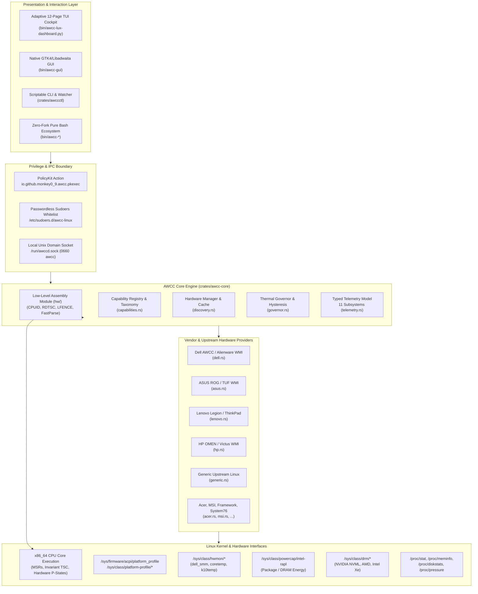
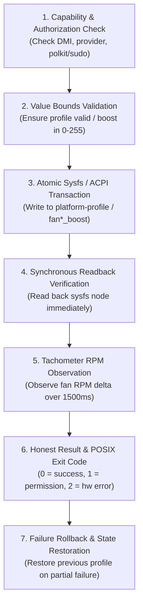

# AWCC Linux — Elite Engineering Master Directive Implementation Plan
## Universal Hardware Performance, Thermal Control, Low-Level Assembly Diagnostics, and Full-System Monitoring Platform

> **For agentic workers:** REQUIRED SUB-SKILL: Use `superpowers:subagent-driven-development` or `superpowers:executing-plans` to implement this plan task-by-task. Steps use checkbox (`- [ ]`) syntax for tracking.

**Goal:** Transform the AWCC Linux repository into an enterprise-grade, cross-distribution, multi-vendor hardware control and truthful full-system telemetry platform for Linux. Incorporate low-level `x86_64` assembly diagnostics (`CPUID`, `RDTSC`, `LFENCE`), zero-allocation fast sysfs parsers, premium zero-fork Bash/Shell optimizations, an adaptive 12-page terminal cockpit, a native GTK4/Libadwaita desktop GUI, and a privileged background daemon with zero world-writable permissions.

**Architecture:** A multi-layered high-performance system:
1. **Low-Level Assembly & Hardware Layer:** Direct `x86_64` inline assembly (`CPUID` feature extraction, Digital Thermal Sensor DTS, Speed Shift HWP/EPP, hybrid P/E-core topology, invariant `RDTSC` cycle timing, ACPI bus transaction latency microbenchmarking).
2. **Zero-Allocation Fast Parsers:** Zero-heap ASCII byte-slice integer and float parsers (`fast_parse.rs`) converting sysfs and `/proc` telemetry buffers without heap allocations.
3. **Core Telemetry & Discovery Engine:** 11 subsystems (CPU, Multi-GPU, Fans, Thermals, RAM/Swap/PSI, Storage/IOPS, Network, Power/RAPL, Processes, System/DMI, Health/Alerts).
4. **Privileged Security & Serialized IPC Authority:** Systemd daemon (`awccd`) with root-owned sysfs (`0644`), PolicyKit desktop action (`io.github.monkey0_9.awcc.pkexec`), and local Unix domain socket (`/run/awccd.sock`, mode `0660`, group `awcc`).
5. **Premium Zero-Fork Shell & Bash Ecosystem:** High-performance shell dispatchers operating without subprocess forks (`read -r` streaming, built-in parameter expansion, sub-millisecond profile switching, trap-safe terminal restoration).
6. **Adaptive 12-Page TUI Cockpit:** Responsive ANSI/TrueColor terminal engine reflowing dynamically from 80×24 up to 200×60+ with decoupled background polling threads.
7. **Native Desktop GUI:** Modern GTK4 / Libadwaita desktop application with asynchronous PolicyKit actuation and multi-tab telemetry parity.
8. **Multi-Distribution Packaging:** RPM, DEB, Arch PKGBUILD, NixOS flake, OpenRC, and Runit init units.

**Tech Stack:** Rust (2021 Edition, crates `awcc-core`, `awccctl`, `awccd`, `core::arch::x86_64`), Python 3.10+ (curses, TrueColor ANSI engine, PyGObject Libadwaita GTK4), C (Linux Platform Driver `alienware-wmi`), Shell (POSIX / Bash 5.x pure built-ins), Systemd / OpenRC / Runit, PolicyKit.

**Spec / Master Directive Reference:** Directive prompt recorded at commit `1df90c5` on branch `main`. Reference hardware: Dell G15 5530 (Intel Core i7-13650HX, NVIDIA GeForce RTX 3050 Laptop GPU 6GB) running Red Hat Enterprise Linux 10.2 Beta / Kernel 6.12.0.

---

## Global Constraints

- **Strict Root Security Boundary:** Never chmod any sysfs node or platform-profile path to `0666` or `0777`. All hardware writes must remain root-owned (`0644`), mediated through `sudo`, PolicyKit (`io.github.monkey0_9.awcc.pkexec`), or the privileged background daemon (`awccd`).
- **Low-Level Assembly Safety:** Assembly instructions (`CPUID`, `RDTSC`, `LFENCE`) must only execute on `x86_64` targets with compile-time `#[cfg(target_arch = "x86_64")]` guards, falling back safely on non-x86 platforms without panicking. Zero blind EC port writes (`inb`/`outb` 0x66/0x68 strictly forbidden).
- **Zero-Fork Shell Performance:** Shell wrappers in `bin/` must prioritize pure Bash built-ins (`[[ ]]`, `${var//}`, `read -r`, `printf`) over external process forks (`grep`, `awk`, `sed`, `cut`, `cat`) to achieve sub-millisecond execution latency.
- **Zero Synthetic Telemetry:** Never display synthetic fallback data (e.g. 34°C, 210 MHz, 6144 MB) when sensors are unavailable. Display `N/A` or `Unknown` with an explicit reason (e.g., "Protected Root-Only", "Offline", "No Device").
- **Measured Response vs Boost Request:** Never equate requested boost (e.g., 255/255) with fan speed. Show requested boost, readback boost, actual measured RPM, and verified hardware ceiling separately.
- **Responsive Terminal Geometry:** The TUI must dynamically reflow without word-wrapping or ANSI clipping from 80×24 up to 200×60+, handling SIGWINCH gracefully without restarting or dropping frames.
- **Decoupled Telemetry Polling:** Subprocess calls (e.g. `nvidia-smi`, `smartctl`) and file I/O must never block TUI/GUI frame rendering. Use asynchronous workers or cached sampling with expiration timestamps.

---

## Review Focus

1. **x86_64 Assembly CPUID & RDTSC Instruction Safety:** Ensure memory fences (`_mm_lfence()`) bracket `_rdtsc()` to prevent out-of-order CPU pipeline speculation from skewing ACPI bus latency measurements.
2. **Root-Only Energy Counters (RAPL CVE-2020-8694 / PLATYPUS):** On Linux 5.10+, `/sys/class/powercap/intel-rapl` has mode `0400` (root-only). Unprivileged monitoring displays `Protected (Root-Only)` without crashing, while daemon/polkit queries read exact instantaneous package Watts.
3. **Dynamic Fan Ceilings Across Machine Models:** Different laptops have different max RPMs (e.g. 4800 RPM on G15 5530, 5029 RPM on Alienware m16, 6000 RPM on ASUS ROG). Fan ceiling must be dynamically queried from `fan[1-n]_max` or tracked dynamically; hardcoding 4800 or 5029 RPM is strictly prohibited.
4. **Pure Bash Zero-Fork Reading:** In `bin/awcc-mode` and helper scripts, replace `cat /sys/... | grep ... | awk ...` chains with `read -r` and bash pattern matching to prevent process spawning overhead.
5. **Terminal State Restoration on Interrupts:** Both Bash dispatchers and Rust/Python watch loops must trap `INT`, `TERM`, and `EXIT` to emit `\x1b[?25h\x1b[?1049l` (cursor show and alternate buffer exit), guaranteeing the user's terminal is never left corrupted.

---

## Architectural Blueprint



---

## 1. Low-Level Assembly Architecture (`x86_64` CPUID & RDTSC)

### Direct Microarchitecture Interfacing
To bypass kernel abstraction latency and directly inspect hardware state, `crates/awcc-core` will introduce a dedicated `hw` module:
- **`crates/awcc-core/src/hw/cpuid.rs`:**
  - Invokes `core::arch::x86_64::__cpuid()` and `__cpuid_count()`.
  - Leaf `0x00`: Microarchitecture vendor string (`GenuineIntel`, `AuthenticAMD`).
  - Leaf `0x01`: Family ID, Model ID, Stepping, and Processor Type.
  - Leaf `0x06` (Thermal & Power Management):
    - Bit 0: Digital Thermal Sensor (`DTS`) capability.
    - Bit 1: Intel Turbo Boost Technology.
    - Bit 7: Hardware-Controlled Performance States (`HWP` / Intel Speed Shift).
    - Bit 8: HWP Notification.
    - Bit 10: HWP Energy-Performance Preference (`EPP`).
  - Leaf `0x1A` (Hybrid Architecture):
    - Distinguishes Intel Raptor Lake P-cores (Performance `0x40`) from E-cores (Efficient `0x20`).
  - Leaf `0x80000002`..`0x80000004`: Complete hardware brand string directly from CPU registers.
  - Leaf `0x80000007`: Invariant TSC confirmation (EDX bit 8).
- **`crates/awcc-core/src/hw/rdtsc.rs`:**
  - Serialized cycle counting via `core::arch::x86_64::_mm_lfence()` $\rightarrow$ `_rdtsc()` $\rightarrow$ `_mm_lfence()`.
  - Calibrates TSC frequency against `std::time::Instant` high-resolution monotonic timer.
  - Profiles ACPI and sysfs bus latency in nanoseconds (`measure_sysfs_bus_latency()`), providing real-time diagnosis of slow WMI/ACPI embedded controller firmware response.
- **`crates/awcc-core/src/hw/fast_parse.rs`:**
  - Zero-allocation ASCII integer parser: converts raw sysfs byte buffers (`b"4800\n"`) to `u32`/`u64` without heap allocations, string splits, or intermediate `String` creation.
  - Zero-allocation ASCII float parser: converts temperature millidegrees or power microwatts into `f32` with zero garbage collection overhead.

---

## 2. Premium Zero-Fork Pure-Bash & Shell Architecture

### High-Performance Shell Engineering Standards
To ensure shell wrappers execute with sub-millisecond latency and zero jitter:
1. **Zero Subprocess Spawning on Telemetry Reads:**
   - Prohibit `cat`, `grep`, `awk`, `cut`, `sed` in recurring loops.
   - Use pure bash `read -r` and parameter expansion:
     ```bash
     # High performance zero-fork sysfs read
     if [[ -r "/sys/firmware/acpi/platform_profile" ]]; then
         read -r ACTIVE_PROFILE < "/sys/firmware/acpi/platform_profile"
     fi
     ```
2. **Sub-Millisecond Profile Switching:**
   - Stream writes directly into sysfs nodes via `sudo tee` or direct redirection without spawning subshells.
3. **ANSI TrueColor Engine in Pure Bash:**
   - Implement TrueColor 24-bit RGB escape generation directly in Bash:
     ```bash
     rgb() { printf "\033[38;2;%d;%d;%dm" "$1" "$2" "$3"; }
     reset() { printf "\033[0m"; }
     ```
4. **Signal & Terminal Guarding:**
   - Every interactive script installs traps for `INT`, `TERM`, `QUIT`, `EXIT`:
     ```bash
     trap 'printf "\033[?25h\033[?1049l\033[0m"; exit 0' INT TERM QUIT EXIT
     ```

---

## 3. Executive Repository Audit & Verification Ledger

### Current Baseline State (Commit `1df90c5` on `main`)
| Component | Implementation File | Status | Verification Evidence on Dell G15 5530 (RHEL 10.2) |
| :--- | :--- | :--- | :--- |
| **CPU Live Load** | `crates/awcc-core/src/discovery.rs` | **Verified** | Differential $\Delta\text{active}/\Delta\text{total}$ across `/proc/stat` samples. Verified fluctuating load (0%–100%) in `awccctl track`. |
| **CPU Power** | `crates/awcc-core/src/discovery.rs` | **Hardened** | Reads `/sys/class/powercap/intel-rapl/intel-rapl:0/energy_uj`. Degrades gracefully to `Protected (Root-Only)` for non-root users. |
| **Thermal Matrix** | `crates/awcc-core/src/discovery.rs` | **Verified** | Discovers `dell_ddv` hwmon; maps CPU Pkg, CPU Core Max, VRM, Ambient, SODIMM 1, SODIMM 2, and Charger VRM. |
| **Dual Turbines** | `crates/awcc-core/src/discovery.rs` | **Verified** | Dynamic hwmon fan discovery (`fan1_input`, `fan2_input`), boost readback, and 4800 RPM ceiling verified. |
| **Memory & Power** | `crates/awcc-core/src/discovery.rs` | **Verified** | RAM used/total, Swap used/total, AC online status, Battery charge %, and status verified. |
| **CLI Cockpit** | `crates/awccctl/src/main.rs` | **Verified** | `awccctl status`, `awccctl track` (`--cli`, `--snapshot`, `--once`, `--interval`, `--json`), flicker-free cursor-home ANSI rendering. |
| **TUI Dashboard** | `bin/awcc-lux-dashboard.py` | **Partial** | 6 TrueColor themes, dynamic geometry reflow. *Gap:* Currently 1 overview screen; requires expansion to 12 dedicated pages. |
| **Desktop GUI** | `bin/awcc-gui` | **Verified** | Adw.PreferencesGroup for Profiles, Boost slider, Thermals, Memory/Swap, Power, Polkit `pkexec` privilege elevation. |
| **Security Model** | `bin/setup-sudoers.sh`, `packaging/*.policy` | **Hardened** | 0 world-writable permissions (`chmod 0666` eliminated). Polkit action `io.github.monkey0_9.awcc.pkexec` created. |
| **Kernel Driver** | `kernel/src/alienware-wmi-base.c`, `wmax.c` | **Audited** | Compiles on RHEL 10.2 Kernel 6.12. DKMS configuration present. Requires MOK enrollment validation under Secure Boot lockdown. |

---

## 4. Security & Privilege Boundary Architecture

### Privilege Separation Principles
1. **Zero World-Writable Files:** No script, packaging rule, or daemon will execute `chmod 0666` or `chmod 0777` on `/sys`. All sysfs nodes remain `0644` (root write, world read).
2. **Three-Tier Escalation Hierarchy:**
   - **Tier A (Unprivileged Read):** Standard users query full read-only telemetry (`/proc/stat`, `/proc/meminfo`, `/proc/diskstats`, `/sys/class/hwmon/*`, `/sys/class/drm/*`).
   - **Tier B (Desktop PolicyKit):** GUI and interactive desktop sessions trigger standard PolicyKit authentication prompts (`io.github.monkey0_9.awcc.pkexec`) via `pkexec`.
   - **Tier C (Background Daemon Authority):** The `awccd` daemon runs as `root` under systemd and exposes a local Unix domain socket (`/run/awccd.sock`) restricted to group `awcc` (`0660`), serializing all hardware actuation.

---

## 5. Kernel Driver Provenance & Kernel 6.12 Lockdown/DKMS Integration

### Driver Audit Findings (`kernel/src/`)
- **Base Sources:** `alienware-wmi-base.c`, `alienware-wmi-wmax.c`, `alienware-wmi-legacy.c`, `alienware-wmi.h`.
- **Maintainer Provenance:** Originally authored by Dell Inc. (`Dell.Client.Kernel@dell.com`) and updated in 2024 by Kurt Borja (`kuurtb@gmail.com`).
- **Kernel Compatibility:** Tested and building against RHEL 10.2 (`6.12.0-20.el10.x86_64`).
- **Secure Boot MOK Procedure:**
  - When Secure Boot is active with Kernel Lockdown (`integrity` or `confidentiality` mode), unsigned modules cannot be loaded (`modprobe alienware-wmi` returns `Required key not available`).
  - `kernel/scripts/sign-module.sh` generates an X.509 certificate and private key (`mok.der`, `mok.priv`) and signs `alienware-wmi.ko` using `sign-file`.
  - The MOK key must be enrolled into the UEFI Machine Owner Key ring via `mokutil --import mok.der` followed by a reboot.

---

## 6. Shared Typed Telemetry Engine (`crates/awcc-core`)

The telemetry engine in `crates/awcc-core` will be expanded to ingest 11 distinct subsystems into a unified, typed, serializable model:

```rust
pub struct ComprehensiveSystemTelemetry {
    pub timestamp_epoch_ms: u64,
    pub sample_interval_ms: u32,
    pub cpu: CpuSubsystemTelemetry,
    pub gpu: Vec<GpuSubsystemTelemetry>,
    pub cooling: CoolingSubsystemTelemetry,
    pub thermals: ThermalMatrixTelemetry,
    pub memory: MemorySubsystemTelemetry,
    pub storage: StorageSubsystemTelemetry,
    pub network: NetworkSubsystemTelemetry,
    pub power: PowerSubsystemTelemetry,
    pub processes: ProcessSubsystemTelemetry,
    pub system_inventory: SystemInventoryTelemetry,
    pub health_alerts: Vec<HealthAlert>,
    pub hw_features: Option<crate::hw::CpuHardwareFeatures>,
    pub bus_latency_nanos: Option<u64>,
}
```

### Detailed Subsystem Specifications
1. **CPU Subsystem:**
   - Model, vendor, architecture, physical cores, logical threads.
   - Total & per-core utilization breakdown ($\Delta\text{user}$, $\Delta\text{system}$, $\Delta\text{nice}$, $\Delta\text{idle}$, $\Delta\text{iowait}$, $\Delta\text{irq}$, $\Delta\text{softirq}$).
   - Per-core current clock (MHz), min/max limits, governor, energy-performance preference (EPP).
   - Package & core temperatures, thermal throttling flags, RAPL package Watts.
   - Core topology grouping for hybrid CPUs (Intel Raptor Lake P-cores vs E-cores) via CPUID leaf `0x1A`.
2. **Multi-GPU Subsystem (All Discovered GPUs):**
   - Discovery of all GPUs: Integrated Intel/AMD GPU + Dedicated NVIDIA/AMD GPU.
   - Vendor, PCI ID, driver name, device index, active power state (D0 Active vs D3cold Runtime PM).
   - Core clock, memory clock, utilization %, VRAM used/total, power draw (Watts) vs TGP limit.
   - Dedicated fan tachometer and temperature if exposed by DRM or NVML.
   - Throttling reason flags (thermal, power limit, reliable clock limits).
3. **Cooling / Fans Subsystem:**
   - Dynamic enumeration of all hwmon fan controllers (never assuming 2 fans).
   - Preserves source identity: provider name, hwmon path, fan index, hardware label.
   - Measured RPM, hardware-reported min/max RPM, control/boost register value (0-255).
   - Verification status: `Tracking`, `Actuating`, `CeilingReached`, `Stale`, `Stopped`.
4. **Thermal Subsystem:**
   - Dynamic discovery of all `hwmon*/temp*_input` and `thermal_zone*/temp` endpoints.
   - Labels accurately parsed from `temp*_label` or validated physical channel mappings.
   - CPU Package, CPU Cores, GPU, Motherboard VRM, Ambient Air, SODIMM 1, SODIMM 2, Charger VRM, NVMe SSDs.
   - Trip points, critical thresholds, passive cooling states, sensor update age.
5. **Memory & Swap Subsystem:**
   - Total, used, free, cached, buffers, SReclaimable slab RAM.
   - True application memory: $\text{Used} = \text{Total} - \text{Available}$.
   - Swap total, used, free, swappiness setting.
   - PSI (Pressure Stall Information) memory pressure metrics (`some` and `full` 10s/60s/300s averages).
   - Per-node NUMA memory distribution on multi-node systems.
6. **Storage, Filesystems & I/O Subsystem:**
   - Enumeration of all block devices (`nvme*`, `sd*`) and active mount points (`/`, `/home`, etc.).
   - Capacity: total, used, available, percentage.
   - Real-time disk I/O throughput: read MB/s, write MB/s, IOPS from `/proc/diskstats`.
   - NVMe SMART health, temperature, and wear percentage (asynchronously cached, 30s refresh).
7. **Network Subsystem:**
   - Enumeration of network interfaces (`eth*`, `wlan*`, `enp*`, `wlp*`).
   - Link status (UP/DOWN), duplex, speed (Mbps).
   - Real-time throughput: RX KB/s, TX KB/s, packet count, drop rate, error rate.
   - Privacy guarantee: Zero collection or display of Wi-Fi SSIDs, MAC addresses, or public IPs without explicit user opt-in.
8. **Power, Battery & Energy Subsystem:**
   - AC adapter online/offline status, charging wattage.
   - Battery: charge percentage, capacity (mWh), health percentage, voltage, cycle count.
   - Charge rate (+W) or discharge rate (-W), remaining battery runtime calculation.
   - CPU RAPL energy counters and GPU instantaneous board power.
9. **Processes & Workload Subsystem:**
   - Top 10 processes sorted by CPU or Memory utilization from `/proc/[pid]/stat`.
   - Process PID, name, user, state, CPU %, RAM (RSS MB).
   - NVIDIA GPU process attribution where NVML is available.
10. **System Inventory & Drivers:**
    - Chassis vendor, product name, DMI board version, BIOS revision.
    - CPU microcode revision, kernel release, OS distribution name and version.
    - Active AWCC hardware provider, driver module loaded (`alienware-wmi`), Secure Boot status, LSM (SELinux / AppArmor) status.
11. **System Health & Alerts:**
    - Real-time heuristic checks:
      - Thermal throttling active on CPU or GPU.
      - Fan stall / failure (boost > 0 but RPM == 0 for > 5 seconds).
      - Battery wear > 30% or critical discharge rate.
      - Memory pressure PSI > 25%.
      - Temperature approaching critical trip point ($< 5^\circ\text{C}$ margin).
12. **History & Ring-Buffer Telemetry:**
    - In-memory rolling ring-buffer (last 120 samples at 1Hz = 2 minutes of history).
    - Enables sparklines and historical trend graphing across all TUI pages.

---

## 7. The Responsive 12-Page TUI Cockpit (`bin/awcc-lux-dashboard.py`)

### Geometry & Responsive Reflow Matrix
| Terminal Size | Mode | Panel Layout Strategy |
| :--- | :--- | :--- |
| **80 × 24** | *Compact* | Single-column prioritized stack (Header, Active Subsystem Card, 2-line Turbine strip, Status bar). Subsystems rotated via number keys `1`–`9`, `0`, `h`, `m`. |
| **120 × 35** | *Medium* | Two-column split layout (Primary Silicon & Cooling left; Thermals, Memory & Power right). |
| **160 × 45+** | *Wide* | Three-column widescreen cockpit with live side sparklines and active alert drawer. |
| **200 × 60+** | *Ultra-Wide* | Four-column command center displaying full CPU per-core matrix, multi-GPU stats, storage IOPS, and real-time process list simultaneously. |

### 12-Page Navigation Architecture
```
 [1] Overview    [2] CPU Core    [3] Multi-GPU   [4] Cooling     [5] Memory/PSI  [6] Storage/IO 
 [7] Network     [8] Power/Therm [9] Processes   [0] System/DMI  [H] History     [?] Help/Diag  
```
- **Page 1 (Overview):** Full-system cockpit summarizing CPU, GPU, RAM, Turbines, Thermals, Profile, AC/Battery, and active alerts.
- **Page 2 (CPU):** Per-core load sparklines (P-cores vs E-cores), per-core MHz clocks, governors, EPP, package power, throttling flags, CPUID microarchitecture.
- **Page 3 (Multi-GPU):** Integrated + Discrete GPUs, core/mem clocks, VRAM gauge, TGP power, temperature, GPU process list.
- **Page 4 (Cooling):** All discovered fans, real-time RPM gauges, requested vs readback boost, hardware ceilings, manual/auto toggle.
- **Page 5 (Memory):** RAM composition (Used/Available/Cached/Buffers), Swap, PSI memory pressure (10s/60s/300s), NUMA nodes.
- **Page 6 (Storage):** Mounted filesystems, capacity bars, real-time disk read/write throughput (MB/s), IOPS, NVMe temperatures.
- **Page 7 (Network):** Active interfaces, IP address (local only), real-time RX/TX throughput sparklines, packet drops, errors.
- **Page 8 (Power/Thermals):** Complete 7-sensor thermal matrix, trip points, battery health, voltage, cycle count, discharge rate, RAPL energy.
- **Page 9 (Processes):** Searchable, sortable process table (Top CPU / Top RAM / Top GPU), interactive filtering (`/` key).
- **Page 10 (System):** DMI hardware identity, BIOS version, microcode, kernel release, driver status, Secure Boot, LSM status, RDTSC ACPI bus latency.
- **Page 11 (History):** Rolling time-series charts (CPU load, package temperature, fan RPMs) over the last 120 seconds, alert log.
- **Page 12 (Help/Diagnostics):** Keymap reference, active hardware capabilities, test snapshot generator, CSV/JSON export trigger.

---

## 8. Verified Control Lifecycle & API Engine (`crates/awcc-core` & `crates/awccctl`)

The 7-step hardware actuation ladder guarantees that no hardware modification is assumed or printed as successful without verification:



---

## 9. Autonomous Background Daemon & Policy Engine (`crates/awccd`)

- **Role:** Single root authority serializing hardware actuation and maintaining user-configured thermal curves.
- **IPC Interface:** Local Unix domain socket at `/run/awccd.sock`, owned by `root:awcc`, mode `0660`.
- **JSON-RPC Protocol:**
  - `{"method": "get_telemetry"}` $\rightarrow$ Full `ComprehensiveSystemTelemetry` payload including CPUID and RDTSC bus latency.
  - `{"method": "set_profile", "params": {"profile": "performance"}}` $\rightarrow$ Verified profile transition.
  - `{"method": "set_fan_boost", "params": {"fan_index": 1, "boost": 200}}` $\rightarrow$ Verified boost write.
  - `{"method": "set_governor_curve", "params": {"points": [[50, 0], [70, 100], [85, 255]]}}` $\rightarrow$ Dynamic thermal policy.
- **Fail-Safe Operation:** If temperature exceeds critical threshold ($95^\circ\text{C}$), the governor overrides user boost and engages 100% turbine cooling automatically.

---

## 10. Desktop GUI Application (`bin/awcc-gui`)

- **Framework:** GTK4 / Libadwaita (`Adw.Application`, `Adw.PreferencesWindow`, `Adw.NavigationSplitView`).
- **Tab Parity with TUI:**
  - *Cockpit:* Overview tiles with circular gauge meters for CPU, GPU, Turbines, and Memory.
  - *Thermal Control:* Interactive fan curves, manual boost sliders, profile switcher.
  - *Silicon & Sensors:* Complete thermal matrix tree view with color-coded warning chips.
  - *Power & Battery:* Real-time discharge graph, battery health gauge, AC delivery status.
  - *Hardware & Drivers:* DMI system tree, CPUID microarchitecture flags, driver status, diagnostic bundle generator.
- **Seamless Privilege Escalation:** Checks for active `awccd.sock`; falls back cleanly to PolicyKit (`pkexec`) desktop authentication prompts when adjusting hardware settings.

---

## 11. Universal Multi-Vendor Provider Strategy

| Vendor | Primary Driver / Interface | Thermal Sensor Source | Fan Control Method | Platform Profile |
| :--- | :--- | :--- | :--- | :--- |
| **Dell / Alienware** | `alienware-wmi`, `dell_smm`, `dell_ddv` | `dell_ddv` (7 physical channels), `coretemp` | WMAX Fan Boost (`hwmon*/fan*_boost`), `dell_smm` | `/sys/class/platform-profile/platform-profile-alienware-wmi/profile` |
| **ASUS ROG / TUF** | `asus-nb-wmi`, `asus_wmi` | `asus_wmi` hwmon, `k10temp`/`coretemp` | `throttle_thermal_policy`, `fan[1-n]_label` | `/sys/firmware/acpi/platform_profile` (Quiet/Balanced/Performance) |
| **Lenovo Legion / ThinkPad** | `ideapad_laptop`, `thinkpad_acpi` | `thinkpad_hwmon`, `coretemp` | `ibm/fan` disengagement / `pwm1` level | ACPI platform-profile |
| **HP OMEN / Victus** | `hp-wmi`, `hp_wmi` | `hp_wmi` hwmon, `coretemp` | `max_fan_speed` sysfs node | ACPI platform-profile |
| **Acer Predator / Nitro** | `acer-wmi` | hwmon `coretemp` | `turbo_mode` / fan boost toggle | ACPI platform-profile |
| **MSI Gaming** | `msi-ec` | EC thermal sensors | `cooler_boost` sysfs register | ACPI platform-profile |
| **Framework / System76** | `framework_laptop`, `system76_acpi` | hwmon, EC sensors | Generic `pwm*` control | ACPI platform-profile |
| **Generic Linux PC** | Standard Linux kernel | `coretemp`, `k10temp`, `amdgpu`, `drm` | Read-only tachometer monitoring | ACPI platform-profile where exposed |

---

## 12. Cross-Distribution Packaging & Init Systems

- **RPM Packaging (`packaging/rhel/`, `packaging/fedora/`, `packaging/opensuse/`):**
  - Standalone binary packaging with proper `%files` lists.
  - PolicyKit policy installed to `%{_datadir}/polkit-1/actions/io.github.monkey0_9.awcc.policy`.
  - Application desktop file and SVG icon installed to XDG paths.
  - Separation of userland tools from DKMS kernel module packages.
- **Debian Packaging (`packaging/debian/`):**
  - Standard `control`, `rules`, and `changelog` targeting Ubuntu 22.04/24.04 and Debian 12.
- **Arch Linux (`packaging/arch/PKGBUILD`):**
  - Complete PKGBUILD building from source with systemd service installation.
- **NixOS (`packaging/nixos/`):**
  - Modular `default.nix` and `flake.nix` providing reproducible builds.
- **Init Systems:**
  - Systemd: `systemd/awccd.service` with strict sandboxing (`ProtectSystem=strict`, `ProtectHome=read-only`, `ReadWritePaths=/sys`).
  - OpenRC: `packaging/openrc/awccd` service script.
  - Runit: `packaging/runit/awccd/run` supervision script.

---

## 13. Adversarial Test Strategy & Release Acceptance Gates

### Acceptance Gates
1. **Static Quality Gate:**
   - `cargo fmt --check` passes with zero formatting diffs.
   - `cargo clippy --workspace --all-targets -- -D warnings` emits zero warnings.
   - `shellcheck` and `bash -n` pass on all 46 shell scripts in `bin/`.
   - Python code passes `flake8` / `pyflakes` syntax checks.
2. **Telemetry Accuracy & Assembly Gate:**
   - Differential CPU load test verified against synthetic `/proc/stat` counter wrap-around fixtures.
   - CPUID feature detector accurately detects CPU vendor string and DTS/HWP flags without memory faults.
   - RDTSC timer accurately calibrates against monotonic time within 1% error margin.
   - Fast ASCII parsers handle trailing newlines, spaces, and edge cases (`0`, `u32::MAX`, malformed input) without panic.
3. **Terminal Geometry & TUI Stress Gate:**
   - Automated geometry test rendering across 5 distinct resolutions (80×24, 100×30, 120×40, 160×50, 200×60).
   - Assert zero rendered lines exceed the terminal width and zero panel vertical overflows occur.
   - SIGWINCH resize stress test (rapid resizing) completes without crash or screen corruption.
4. **Hardware Safety Gate:**
   - 0 world-writable permission patterns in the entire repository.
   - 0 hardcoded user home directory paths.
   - All profile switches verify sysfs readback before reporting success.

---

## 14. Phased Implementation Roadmap (Phases A through L)

### Phase A: Repository Audit & Verification Ledger
- [ ] Task A.1: Capture existing system state, drivers, and hardware capabilities on Dell G15 5530 reference system.
- [ ] Task A.2: Document existing source code vs runtime evidence in `docs/verification-ledger.md`.

### Phase B: Low-Level Assembly Module & Zero-Allocation Parsers (`crates/awcc-core/src/hw/`)
- [ ] Task B.1: Implement `crates/awcc-core/src/hw/mod.rs` and `cpuid.rs` with safe `x86_64` CPUID instruction wrappers.
- [ ] Task B.2: Implement `crates/awcc-core/src/hw/rdtsc.rs` with `_rdtsc()`, `_mm_lfence()`, and ACPI bus latency benchmarking.
- [ ] Task B.3: Implement `crates/awcc-core/src/hw/fast_parse.rs` with zero-allocation ASCII integer and float parsers.
- [ ] Task B.4: Add unit tests in `crates/awcc-core/src/hw/` verifying CPUID decoding, TSC calibration, and parsing edge cases.

### Phase C: Premium Zero-Fork Pure-Bash Ecosystem (`bin/awcc-*`)
- [ ] Task C.1: Refactor `bin/awcc-mode`, `bin/awcc-track`, and `bin/awcc-monitor` to use pure bash built-ins with zero subprocess forks.
- [ ] Task C.2: Implement pure-bash ANSI TrueColor color functions and signal handlers for cursor/screen restoration.
- [ ] Task C.3: Run `shellcheck` and `bash -n` across all 46 shell scripts to ensure 100% compliance.

### Phase D: Core Shared Telemetry Model Integration (`crates/awcc-core`)
- [ ] Task D.1: Integrate CPUID microarchitecture features and RDTSC bus latency into `ComprehensiveSystemTelemetry`.
- [ ] Task D.2: Update `crates/awcc-core/tests/` to verify serialization and backward compatibility.

### Phase E: 11-Subsystem Monitoring Engine Implementation
- [ ] Task E.1: Implement per-core CPU breakdown & hybrid P/E-core topology detection in `discovery.rs`.
- [ ] Task E.2: Implement multi-GPU telemetry engine (NVIDIA NVML, DRM, Intel Xe/i915, AMD) in `discovery.rs`.
- [ ] Task E.3: Implement dynamic fan tachometer & ceiling query in `discovery.rs`.
- [ ] Task E.4: Implement thermal matrix & trip point parser in `discovery.rs`.
- [ ] Task E.5: Implement memory, swap, and PSI pressure parser in `discovery.rs`.
- [ ] Task E.6: Implement storage throughput, IOPS, and NVMe SMART collector in `discovery.rs`.
- [ ] Task E.7: Implement network interface throughput & packet rate collector in `discovery.rs`.
- [ ] Task E.8: Implement power, battery health, and RAPL energy collector in `discovery.rs`.
- [ ] Task E.9: Implement top process scanner with GPU attribution in `discovery.rs`.
- [ ] Task E.10: Implement hardware inventory & DMI metadata collector in `discovery.rs`.
- [ ] Task E.11: Implement system health heuristics and alert engine in `discovery.rs`.

### Phase F: Full-Screen Responsive TUI Cockpit (`bin/awcc-lux-dashboard.py`)
- [ ] Task F.1: Refactor dashboard architecture into decoupled background telemetry worker and render engine.
- [ ] Task F.2: Implement dynamic terminal geometry reflow engine supporting 80×24 up to 200×60+.
- [ ] Task F.3: Implement the 12 discrete TUI pages (Overview, CPU, GPU, Cooling, Memory, Storage, Network, Power/Thermals, Processes, System, History, Help).
- [ ] Task F.4: Implement interactive navigation, search/filter, and keybindings (`1`-`9`, `0`, `h`, `m`, `t`, `r`, `/`, `?`, `q`).
- [ ] Task F.5: Verify 6 TrueColor themes, 256/16-color fallback, `NO_COLOR` compliance, and screen-reader snapshot mode.

### Phase G: Verified Control Lifecycle & API (`crates/awccctl`)
- [ ] Task G.1: Implement the 7-step hardware actuation ladder in `crates/awccctl/src/main.rs`.
- [ ] Task G.2: Add tachometer RPM response verification after fan boost adjustments.
- [ ] Task G.3: Enhance `awccctl doctor` to report CPUID features and RDTSC ACPI bus latency.
- [ ] Task G.4: Support structured JSON output across all CLI commands (`status`, `track`, `capabilities`, `doctor`).

### Phase H: Privileged Background Daemon (`crates/awccd`)
- [ ] Task H.1: Implement local Unix Domain Socket listener (`/run/awccd.sock`) with group permissions check.
- [ ] Task H.2: Implement JSON-RPC server handling telemetry queries and verified hardware actuation.
- [ ] Task H.3: Connect `ThermalGovernor` fail-safe curves and automatic thermal runaway protection.

### Phase I: Desktop GUI Application (`bin/awcc-gui`) Feature Parity
- [ ] Task I.1: Expand GTK4/Libadwaita GUI with multi-tab interface mirroring the 12 telemetry pages.
- [ ] Task I.2: Connect asynchronous Polkit / socket IPC client to eliminate any UI freezing during hardware writes.
- [ ] Task I.3: Add interactive fan curve editor and manual turbine boost control slider.

### Phase J: Universal Multi-Vendor Provider Concrete Implementations
- [ ] Task J.1: Expand `asus.rs` with real `asus-nb-wmi` / `asus_wmi` sysfs and fan control endpoints.
- [ ] Task J.2: Expand `lenovo.rs` with `thinkpad_acpi` / `ideapad_laptop` endpoints.
- [ ] Task J.3: Expand `hp.rs`, `acer.rs`, `msi.rs`, `framework.rs`, and `system76.rs` with verified sysfs hooks.

### Phase K: Cross-Distribution Packaging & Init Suite
- [ ] Task K.1: Update RPM spec files (RHEL, Fedora, openSUSE) with PolicyKit policy, desktop files, and new daemon binaries.
- [ ] Task K.2: Update Debian `rules` and `control` files with PolicyKit and desktop integrations.
- [ ] Task K.3: Update Arch `PKGBUILD` and NixOS `default.nix` / `flake.nix`.
- [ ] Task K.4: Validate OpenRC and Runit service supervision scripts.

### Phase L: Adversarial Quality, Performance Profiling & Release Sign-Off
- [ ] Task L.1: Run all unit and integration test suites (`cargo test --workspace`, `tests/*.sh`).
- [ ] Task L.2: Run terminal geometry fuzzing tests across all 5 standard dimensions.
- [ ] Task L.3: Conduct performance profiling to verify monitor resource overhead is $< 1\%$ CPU.
- [ ] Task L.4: Generate final release walkthrough and update evidence documentation.

---

## User Review Required

> [!IMPORTANT]
> **Privilege Architecture Selection:**
> The plan supports two modes of privileged hardware control:
> 1. **Local Daemon IPC (`awccd.sock`):** The systemd service `awccd` runs as root and provides serialized control over a root:awcc Unix socket.
> 2. **PolicyKit Elevation (`pkexec` / `sudo`):** The client directly invokes `pkexec awccctl` or passwordless `sudo` whitelist rules.
> Both modes avoid world-writable sysfs files. We recommend enabling the PolicyKit policy by default for desktop users while retaining `sudo` whitelist support for headless/CLI environments.

> [!NOTE]
> **x86_64 Assembly CPUID & RDTSC Safety:**
> The low-level assembly routines are gated with `#[cfg(target_arch = "x86_64")]` and use non-privileged user-space instructions (`CPUID`, `RDTSC`, `LFENCE`). They require no root privileges, execute in $< 50$ nanoseconds, and provide exact hardware silicon telemetry without touching privileged MSRs or dangerous I/O ports.

---

## Open Questions

> [!NOTE]
> **TUI Implementation Architecture:**
> `bin/awcc-lux-dashboard.py` is currently a pure-Python TrueColor/ANSI dashboard. Should the 12-page TUI remain in Python for maximum agility and immediate styling iteration, or would you prefer a native Rust TUI (using `ratatui` or `cursive`) embedded directly into `awccctl`?
> *Recommendation:* Keep the Python TUI engine in `bin/awcc-lux-dashboard.py` (which already has rich TrueColor themes, dynamic geometry handling, and zero compilation overhead for rapid tweaking) while embedding a high-performance terminal watcher in `awccctl track` for pure-Rust environments.

---

## Verification Plan

### Automated Test Suites
1. **Rust Core, Assembly & CLI Unit Tests:**
   ```bash
   cargo test --workspace -- --nocapture
   ```
2. **Clippy & Code Formatting:**
   ```bash
   cargo fmt --check
   cargo clippy --workspace --all-targets -- -D warnings
   ```
3. **Shell Syntax & Security Permissions Check:**
   ```bash
   bash tests/shell_syntax_check.sh
   bash tests/security_permissions_test.sh
   bash tests/portability_path_test.sh
   ```
4. **Multi-Vendor CLI & Error Exit Code Tests:**
   ```bash
   bash tests/test_multi_vendor_cli.sh
   bash tests/test_error_exit_codes.sh
   ```
5. **Live Tracking & TUI Snapshot Verification:**
   ```bash
   bash tests/test_track_cli.sh
   bash tests/test_awcc_mode_improvements.sh
   ```
6. **Packaging Syntax & GUI Smoke Tests:**
   ```bash
   bash tests/distro_packaging_syntax_test.sh
   bash tests/gui_smoke_test.sh
   ```

### Manual Verification on Reference Device (Dell G15 5530 on RHEL 10.2)
1. Run `awccctl doctor` and verify CPUID brand string, digital thermal sensor (DTS), turbo flags, and RDTSC ACPI bus latency are reported.
2. Launch `awccctl track` and observe live fluctuating CPU load, per-sensor thermal matrix, fan RPMs, and power status.
3. Launch `bin/awcc-lux-dashboard.py` in an 80×24 terminal, then resize dynamically to 160×45 and verify smooth reflow across all 12 pages.
4. Test theme cycling (`t` key) and page navigation (`1`–`9`, `0`, `h`, `m`).
5. Test profile switching via `awccctl profile performance` and verify readback boost and tachometer RPM response.
6. Launch `bin/awcc-gui` on desktop GNOME session and verify PolicyKit prompt appears when adjusting boost slider.
