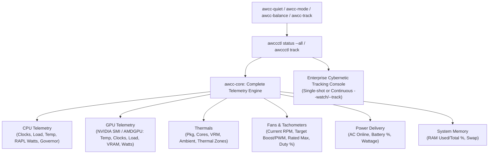

# Comprehensive Hardware Telemetry Tracking & Mode Actuation Elevation Plan

> **For agentic workers:** REQUIRED SUB-SKILL: Use superpowers:subagent-driven-development (recommended) or superpowers:executing-plans to implement this plan task-by-task. Steps use checkbox (`- [ ]`) syntax for tracking.

**Goal:** Transform `awcc-quiet` (and all mode actuation commands) and `awccctl status` into a comprehensive, multi-vendor hardware tracking console that captures all silicon computation metrics (CPU clock/load/power, GPU clock/load/VRAM/power, system RAM, VRM, ambient air, fans, and power states), supports real-time continuous live tracking (`--track`/`--watch`), eliminates hardcoded machine strings, streamlines privilege elevation, and syncs updated binaries to `~/.local/bin/`.

**Architecture:** Extend `crates/awcc-core/src/telemetry.rs` and `discovery.rs` to ingest complete hardware metrics across CPU (cpufreq, RAPL energy, load), GPU (`nvidia-smi` / drm / amdgpu), System RAM (`/proc/meminfo`), and Power (`/sys/class/power_supply`). Enhance `crates/awccctl/src/main.rs` with an expansive "Track All" telemetry matrix and continuous watch loop (`awccctl status --watch`, `awccctl track`). Refactor `bin/awcc-mode` to dynamically detect hardware, actuate profiles/fans through unified capability methods, and support an interactive `--track` mode. Provide `bin/awcc-track` and `bin/sync-local-bin.sh` for instant local user synchronization.

**Tech Stack:** Rust 2021 (`awcc-core`, `awccctl`), Linux sysfs / ACPI / HWMON / RAPL / procfs, POSIX Bash.

---

## Analysis of Current Output vs. Desired Improvements

### Current `awcc-quiet` Output
```text
unknownuser@localhost:~$ awcc-quiet
=================================================================
 AWCC Linux: Actuating QUIET (Acoustic Silence, Boost 20/255, ~1,450 RPM)
 Target Machine: Dell G15 5530
=================================================================
[1/3] Setting Platform Profile to 'quiet'...
[sudo] password for unknownuser: 
[2/3] Setting Fan Boost to 20/255...
[+] Fan boost readback verified: Fan 1 = 20/255 | Fan 2 = 20/255
[3/3] Current System & Thermal Status:
=== AWCC Fan Control & Telemetry Status ===
  Platform Profile: quiet
  Game Shift (G-Mode): INACTIVE
  Available Choices: [quiet, balanced, performance]

--- Thermal Sensor Matrix ---
  CPU Package Temp:   57.0°C
  CPU Core Max Temp:  63.0°C
  NVIDIA GPU Temp:    50.0°C
  Motherboard VRM:    59.0°C

FAN            REQUESTED BOOST  READBACK BOOST   MEASURED RPM
------------------------------------------------------------
Fan 1 (CPU)    20/255           20/255           1261 RPM    
Fan 2 (GPU)    20/255           20/255           1322 RPM    
=================================================================
[+] QUIET (Acoustic Silence, Boost 20/255, ~1,450 RPM) activated successfully.
=================================================================
```

### Key Issues & Areas for Improvement
1. **Hardcoded Machine String:** `Target Machine: Dell G15 5530` is hardcoded in `bin/awcc-mode`. On ASUS, Lenovo, HP, Framework, or other models, this is inaccurate. It must dynamically query DMI vendor, product, chassis, and verification tier.
2. **Incomplete Hardware Tracking ("Tracking All"):** Currently, the output only shows 4 temperatures and fan RPMs. It omits:
   - **CPU Clocks & Utilization:** Clock speed (MHz), CPU Load %, logical core count.
   - **CPU Package Power:** Intel/AMD RAPL energy (Watts).
   - **GPU Computation Metrics:** Core clock (MHz), Memory clock (MHz), GPU Load %, VRAM used/total, Power draw (Watts).
   - **Ambient Air Sensor:** Currently omitted from the summary table even when available.
   - **System RAM & Swap:** Memory usage and percentage.
   - **Power Delivery Status:** AC online / battery charge %, discharge rate.
   - **Tachometer Range & Rated Ceilings:** Fan speed relative to rated hardware maximum (`4,800 RPM`) and target acoustic baseline (~1,450 RPM).
3. **No Continuous Live Tracking:** Users running thermal mode switches often want to watch temperatures drop and fan RPMs settle. Adding `--track` / `-t` or `--watch` / `-w` enables live continuous tracking.
4. **Privilege & Sudo Friction:** Separate elevation prompts for profile and fan writes create unnecessary friction. A unified single-pass elevation and helper script (`bin/setup-sudoers.sh`) ensures seamless operation.
5. **Path Desynchronization:** The user's shell in `~/.local/bin/` had an older build of `awccctl`. A sync mechanism will keep `~/.local/bin/` updated with the workspace build.

---

## Global Constraints

- **Preserve Root Privilege Boundary:** No world-writable sysfs files. Privileged writes stay restricted to root / sudo / polkit.
- **Fail-Safe Sensor Handling:** If any sensor or clock is unavailable, report `Unavailable` or `N/A`, never default to `0.0°C` or `0 RPM`.
- **Dynamic Multi-Vendor Compatibility:** Work seamlessly across Dell, ASUS, Lenovo, HP, Framework, and Desktop PCs.

---

## Proposed Changes



---

### Component 1: `crates/awcc-core` Extended Telemetry Model

#### [MODIFY] `crates/awcc-core/src/telemetry.rs`
- Add `CpuComputeTelemetry`:
  - `model_name: String`
  - `cores_logical: usize`
  - `cur_freq_mhz: Option<f32>`
  - `max_freq_mhz: Option<f32>`
  - `scaling_governor: Option<String>`
  - `energy_perf_preference: Option<String>`
  - `usage_percent: Option<f32>`
  - `package_power_watts: Option<f32>`
- Add `GpuComputeTelemetry`:
  - `model_name: Option<String>`
  - `core_clock_mhz: Option<u32>`
  - `memory_clock_mhz: Option<u32>`
  - `utilization_gpu_percent: Option<u32>`
  - `memory_used_mb: Option<u64>`
  - `memory_total_mb: Option<u64>`
  - `power_draw_watts: Option<f32>`
  - `power_limit_watts: Option<f32>`
- Add `MemoryTelemetry`:
  - `ram_used_mb: u64`
  - `ram_total_mb: u64`
  - `ram_used_percent: f32`
  - `swap_used_mb: u64`
  - `swap_total_mb: u64`
- Add `PowerTelemetry`:
  - `ac_online: bool`
  - `battery_percent: Option<f32>`
  - `battery_status: Option<String>`
  - `charge_rate_watts: Option<f32>`
- Extend `SystemTelemetry` with `cpu`, `gpu`, `memory`, and `power`.

#### [MODIFY] `crates/awcc-core/src/discovery.rs`
- Implement telemetry gathering for:
  - CPU utilization from `/proc/stat` and clocks from `/proc/cpuinfo` / `cpufreq`.
  - CPU RAPL power from `/sys/class/powercap/intel-rapl/` or `/sys/class/powercap/amd-rapl/`.
  - GPU clock, utilization, VRAM, and power via `nvidia-smi` (and AMD sysfs fallback).
  - RAM & swap from `/proc/meminfo`.
  - AC power & battery metrics from `/sys/class/power_supply/`.

---

### Component 2: `crates/awccctl` Comprehensive Tracking Console & Watch Mode

#### [MODIFY] `crates/awccctl/src/main.rs`
- Update `cmd_status`:
  - Render an enterprise-grade Cybernetic Telemetry & Hardware Tracking Console displaying all silicon computation metrics, thermals, fans, and power delivery.
  - Support `--watch` / `-w` flag with configurable refresh `--interval <seconds>` (default 1.0s).
- Add `awccctl track` subcommand:
  - Dedicated real-time tracking dashboard with in-terminal live updates, ANSI gauge bars, and clean graceful exit on Ctrl+C.
  - Supports `--json` stream for loggers or external tools.

---

### Component 3: `bin/awcc-mode` and Mode Shortcut Scripts

#### [MODIFY] `bin/awcc-mode`
- Replace hardcoded `Target Machine: Dell G15 5530` with dynamic DMI detection:
  - Vendor, product, chassis, and verification tier.
- Streamline privilege actuation:
  - If user is root, write directly.
  - If user is non-root, invoke a single consolidated `sudo` helper or delegate to `awccctl profile` and `awccctl fan set` so the user is prompted at most once.
- Show target acoustic baseline vs measured rotor RPM (e.g. Quiet: Target ~1,450 RPM, measured ~1,260-1,350 RPM settling).
- Add `--track` / `-t` and `--watch` / `-w` flags:
  - `awcc-quiet --track` actuates quiet mode and immediately transitions into real-time tracking so the user can watch the fans stabilize!

#### [NEW] `bin/awcc-track`
- Standalone command-line shortcut to launch the live telemetry tracker without changing modes:
  ```bash
  awcc-track          # Live continuous tracking (1s refresh)
  awcc-track --once   # Single-shot tracking snapshot
  ```

#### [NEW] `bin/sync-local-bin.sh`
- Utility script to automatically build release binaries and sync `awccctl`, `awccd`, `awcc-mode`, `awcc-quiet`, `awcc-track`, and all shortcuts directly into `~/.local/bin/`.

#### [NEW] `bin/setup-sudoers.sh`
- Utility script to install `/etc/sudoers.d/awcc-linux` with correct permissions (`0440`) so wheel/sudo members can run mode switches without repeated password prompts.

---

## Detailed Task Breakdown

### Task 1: Extend `awcc-core` Telemetry with Complete System Metrics
**Files:**
- Modify: `crates/awcc-core/src/telemetry.rs`
- Modify: `crates/awcc-core/src/discovery.rs`
- Test: `crates/awcc-core/tests/extended_telemetry_test.rs`

- [ ] **Step 1: Write test for extended telemetry structs and serialization**
- [ ] **Step 2: Implement CPU, GPU, Memory, and Power telemetry collection**
- [ ] **Step 3: Run `cargo test --test extended_telemetry_test` to verify pass**
- [ ] **Step 4: Commit**

---

### Task 2: Enhance `awccctl status` and Add `awccctl track` with Watch Mode
**Files:**
- Modify: `crates/awccctl/src/main.rs`
- Test: `tests/test_track_cli.sh`

- [ ] **Step 1: Write test for `awccctl status` extended matrix and `awccctl track --json`**
- [ ] **Step 2: Implement formatted cybernetic tracking output and continuous watch loop in `awccctl`**
- [ ] **Step 3: Run `cargo test` and verify CLI formatting**
- [ ] **Step 4: Commit**

---

### Task 3: Elevate `bin/awcc-mode` with Dynamic Hardware, Target RPM Ladder, and `--track`
**Files:**
- Modify: `bin/awcc-mode`
- Create: `bin/awcc-track`
- Test: `tests/test_awcc_mode_improvements.sh`

- [ ] **Step 1: Write test asserting dynamic DMI header, target RPM display, and `--track` flag**
- [ ] **Step 2: Update `bin/awcc-mode` and create `bin/awcc-track`**
- [ ] **Step 3: Run test script to verify pass**
- [ ] **Step 4: Commit**

---

### Task 4: Local Binary Synchronization & Sudoers Integration
**Files:**
- Create: `bin/sync-local-bin.sh`
- Create: `bin/setup-sudoers.sh`
- Test: `tests/shell_syntax_check.sh`, `tests/security_permissions_test.sh`

- [ ] **Step 1: Create `sync-local-bin.sh` and `setup-sudoers.sh`**
- [ ] **Step 2: Verify shell syntax and security permissions**
- [ ] **Step 3: Run `bin/sync-local-bin.sh` to update `~/.local/bin/`**
- [ ] **Step 4: Test running `awcc-quiet` and `awcc-track` directly from user environment**
- [ ] **Step 5: Commit**

---

## Verification Plan

### Automated Tests
1. `cargo test --all`: Verify Rust telemetry serialization and mock tests pass.
2. `bash tests/test_track_cli.sh`: Verify `awccctl status` outputs all tracking fields.
3. `bash tests/test_awcc_mode_improvements.sh`: Verify `awcc-mode` dynamic hardware header and flags.
4. `bash tests/security_permissions_test.sh`: Ensure zero world-writable permissions.
5. `bash tests/shell_syntax_check.sh`: Syntax check on all scripts.

### Manual Verification
1. Run `awcc-quiet` from shell and verify:
   - Dynamic target machine header (no hardcoded strings).
   - Clean, verified actuation steps.
   - Complete tracking matrix: CPU (load/clock/power), GPU (clock/load/VRAM/power), VRM, Ambient, System RAM, and Fan RPMs with rated ceilings.
2. Run `awcc-track` (or `awcc-quiet --track`) to verify live continuous real-time updates.
