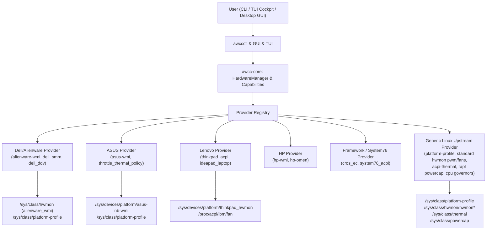

# Universal Linux Hardware Performance & Thermal Control Implementation Plan

> **For agentic workers:** REQUIRED SUB-SKILL: Use superpowers:subagent-driven-development (recommended) or superpowers:executing-plans to implement this plan task-by-task. Steps use checkbox (`- [ ]`) syntax for tracking.

**Goal:** Expand AWCC Linux into a secure, cross-distribution, multi-vendor platform supporting Dell, Alienware, ASUS, Lenovo, HP, Acer, MSI, Framework, System76, and custom desktop/workstation hardware via dynamically discovered capabilities, modular kernel providers, a responsive terminal dashboard, a native GTK4/Libadwaita desktop GUI, system services, and distribution-agnostic packaging.

**Architecture:** Refactor `awcc-core` around a dynamic capability discovery engine (`HardwareCapabilities`) and a modular provider registry (`HardwareProvider` trait). Standard Linux kernel interfaces (`sysfs`, `platform_profile`, `hwmon`, `thermal_zone`, `powercap RAPL`, CPU frequency/EPP) serve as the universal primary foundation; vendor-specific providers (Dell WMAX, ASUS WMI, Lenovo ACPI, HP Omen, Framework/System76) hook in only when evidence exists. The presentation layer provides a feature-gated CLI (`awccctl`), an adaptive full-terminal cockpit (`bin/awcc-lux-dashboard.py`), a modern GTK4/Libadwaita desktop GUI (`bin/awcc-gui`), an autonomous daemon (`awccd`), and multi-distro packaging (RPM, DEB, Arch PKGBUILD, openSUSE, NixOS Flake).

**Tech Stack:** Rust 2021 (workspace with `clap`, `colored`, `serde`, `serde_json`, `signal-hook`, `thiserror`), Python 3 with PyGObject (GTK4 + Libadwaita for modern desktop GUI, standard ANSI TUI for terminal dashboard), Linux sysfs / ACPI WMI / HWMON, POSIX Bash, systemd / OpenRC / runit, RPM / DEB / PKGBUILD / Nix packaging.

**Spec:** User Specification: Universal Linux Hardware Performance & Thermal Control (Multi-Distribution, Multi-Vendor, Dynamic Capabilities).

---

## Live System Audit & Current State Findings

A live run of the current repository against the host machine revealed:
- **Host OS & Kernel:** Red Hat Enterprise Linux 10.2 (Coughlan), Kernel 6.12.0-211.68.1.el10_2.x86_64.
- **Host Hardware:** Dell Inc. Dell G15 5530 (BIOS 1.34.0, 13th Gen Intel Core i7-13650HX, NVIDIA GeForce RTX 3050 6GB Laptop GPU).
- **Desktop Environment:** Wayland (`wayland-0`) & X11 (`:0`) with GTK4 and Libadwaita (`Adw 1`) available.
- **Active Kernel Nodes:**
  - `hwmon3: dell_ddv` (VRM & Ambient temps)
  - `hwmon4: dell_smm`
  - `hwmon5: coretemp` (CPU Package & Cores)
  - `hwmon7: alienware_wmi` (Boost nodes & tachometer RPM)
  - `/sys/class/platform-profile/platform-profile-1` (alienware-wmi class provider)
- **Current Tool Execution:**
  - `awccctl detect`, `status`, `doctor` successfully report live telemetry on Dell hardware.
  - `bin/awcc-lux-dashboard.py --snapshot` renders the cybernetic cockpit.
  - `cargo test` passes 7 existing tests.

### Gap Analysis: What Must Still Be Completed

| Component | Current State | What Must Be Completed |
| :--- | :--- | :--- |
| **Provider Architecture** | Hardcoded to Dell `alienware_wmi`, `dell_smm`, `dell_ddv`. | • Define `HardwareProvider` trait & `ProviderRegistry`.<br>• Implement `GenericLinuxProvider` for standard desktop motherboards and generic laptops (`platform-profile`, standard `hwmon` `fanX_input` / `pwmX` / `pwmX_enable`, `thermal_zone`, `powercap` RAPL, `cpufreq`).<br>• Implement `AsusProvider` (`asus-wmi`, `throttle_thermal_policy`, `asus-ec-sensors`).<br>• Implement `LenovoProvider` (`thinkpad_acpi`, `ideapad_laptop`, dual-fan pwm).<br>• Implement `HpProvider` (`hp-wmi`, `hp-omen`).<br>• Implement `FrameworkSystem76Provider` (`cros_ec`, `system76_acpi`).<br>• Isolate `DellAwccProvider` into its own modular provider. |
| **Capability Engine** | Assumes dual fans with 0-255 boost, Game Shift, and custom profiles. | • Implement `HardwareCapabilities` taxonomy (`FanControlCapability`, `PlatformProfileCapability`, `CpuGovernorCapability`, `VerificationTier`).<br>• Prevent non-Dell/generic systems from failing with `DriverNotFound` when boost is absent; expose read-only or standard PWM controls safely.<br>• Expose `awccctl capabilities` command. |
| **Desktop GUI** | Non-existent (marked as future roadmap). | • Build modern GTK4 / Libadwaita desktop GUI application (`bin/awcc-gui`) with responsive gauge dials, profile selector buttons, capability-gated fan slider, and diagnostic health tab.<br>• Standard FreeDesktop launcher (`packaging/awcc-gui.desktop`) and icon.<br>• Add GUI test harness (`tests/gui_smoke_test.sh`). |
| **Terminal Dashboard** | Hardcoded Dell Alienware labels and exactly 2 fans. | • Generalize `bin/awcc-lux-dashboard.py` to dynamically adapt to detected vendor, chassis, and verification tier badge.<br>• Dynamically render 1, 2, 3, or N fans.<br>• Support AMD CPU (`k10temp`/`zenpower`) and AMD GPU (`amdgpu`).<br>• Disable/gray out Max Fan (M) key when manual fan boost is unsupported. |
| **Multi-Distro Packaging** | Only RHEL spec and basic Arch PKGBUILD exist (`debian/` and `fedora/` empty). | • Complete Debian/Ubuntu packaging (`packaging/debian/control`, `packaging/debian/rules`).<br>• Complete Fedora packaging (`packaging/fedora/awcc-linux.spec`).<br>• Complete openSUSE packaging (`packaging/opensuse/awcc-linux.spec`).<br>• Complete NixOS packaging (`packaging/nixos/flake.nix`, `packaging/nixos/default.nix`).<br>• Fix Arch `PKGBUILD` portability flaws. |
| **Installation & Recovery** | `bin/install-system.sh` is Dell/RHEL-specific and compiles Dell driver unconditionally. | • Multi-distribution installer with `/etc/os-release` and DMI hardware vendor detection.<br>• Clean uninstaller (`bin/uninstall-system.sh`).<br>• Disaster recovery tool (`bin/doctor-recovery.sh`) to reset fans to firmware control and clean locks. |
| **Init Systems** | Only `systemd/awccd.service` exists. | • Generalize `awccd` daemon to support all providers via `HardwareCapabilities`.<br>• Add OpenRC service script (`systemd/openrc-awccd.initd`).<br>• Add Runit service script (`systemd/runit-awccd.run`). |
| **Multi-Vendor Testing** | Only Dell mock tests exist. | • Rust mock tests in `crates/awcc-core/tests/multi_vendor_mock_tests.rs` covering Dell, ASUS, Lenovo, HP, Framework, Desktop Motherboard, and Unsupported PC.<br>• Multi-vendor CLI test script (`tests/test_multi_vendor_cli.sh`).<br>• Distro packaging syntax test (`tests/distro_packaging_syntax_test.sh`). |
| **Evidence Documentation** | Only 5 Dell models in compatibility matrix. | • Expand `docs/compatibility-matrix.md` across Dell, ASUS, Lenovo, HP, Acer, MSI, Framework, System76, and Desktop motherboards with explicit verification tiers.<br>• Author `docs/multi-vendor-guide.md` and `docs/hardware-telemetry-submission.md`. |

---

## Global Constraints

- **No World-Writable Permissions:** No `chmod 0666` or `chmod 0777` on any sysfs node, udev rule, or service configuration. Unprivileged users only read telemetry; privileged actuation requires `sudo`, root daemon, or polkit.
- **Dynamic Capability Discovery:** Never assume manual fan control, maximum fan boost, Game Shift, or custom profiles exist on an unverified device. Expose only operations supported by discovered capabilities; clearly mark untested or unsupported features.
- **Secure Boot & System Safety:** No unsigned kernel writes or raw `/dev/port` / `/dev/mem` EC poking. All actuation must use upstream kernel interfaces or verified signed modules.
- **Upstream-First Architecture:** Prefer standard Linux interfaces (`/sys/class/platform-profile`, `/sys/class/hwmon`, `/sys/class/thermal`, `/sys/class/powercap`) before vendor-specific WMI drivers.
- **Evidence-Based Hardware Matrix:** Explicitly distinguish between `Physically Verified` (tested hardware with tachometer and kernel telemetry evidence), `Community Supported` (recognized quirks), `Generic Upstream Fallback`, and `Unsupported`.
- **Distribution Portability:** Support RHEL, Fedora, Ubuntu, Debian, Arch Linux, Manjaro, openSUSE, Linux Mint, Pop!_OS, and NixOS with native packaging and installation scripts.
- **No Hardcoded Machine Paths:** Zero hardcoded usernames or home directories in scripts, units, or code.

---

## Review Focus

1. **Unsupported Hardware Behavior:** When executed on an arbitrary desktop or non-Dell laptop lacking manual fan boost, `awccctl fan set` or `fan max` must gracefully report that manual fan boost is unsupported on this hardware, exit with a clear diagnostic code, and never crash or falsely claim success.
2. **Missing Telemetry Handling:** If a machine has no GPU, no VRM sensor, or missing tachometer inputs, the engine must return `None` (rendered as `Unavailable`), never fallback to `0.0°C` or `0 RPM`, and never trigger false thermal alarms.
3. **Firmware Safety Return:** When `awccd` daemon or GUI terminates (via SIGTERM, SIGINT, or crash), fans must immediately and reliably revert to firmware/BIOS automatic control.
4. **Cross-Distro Packaging Integrity:** Installation scripts and package specs must accurately detect the host distribution without modifying or clobbering existing system shortcuts or global configurations.
5. **Secure Boot Attestation:** Diagnostic tool (`awccctl doctor`) must verify kernel lockdown state and module signing, warning users if a custom module cannot be loaded under Secure Boot.

---

## User Review Required

> [!IMPORTANT]
> **Rebranding & Core Naming:** The project is expanding from Dell-specific AWCC into a universal platform. We retain `awcc-linux` / `awccctl` as the backwards-compatible command binary while establishing the universal core architecture (`HardwareCapabilities`, `VendorProvider`), with universal aliases provided.
> 
> **Tiered Capability Model:** Unlike Dell AWCC where fans have a direct `0-255` boost offset, standard Linux desktops use standard PWM (`0-255` in `pwmX`), ThinkPads use discrete levels (`0-7`, `disengaged`), and modern ultrabooks manage fans purely through platform profiles (`quiet`, `balanced`, `performance`). The CLI and GUI will dynamically disable manual fan boost buttons on machines where the kernel or hardware does not support manual fan overrides.

---

## Open Questions

> [!NOTE]
> None blocking implementation.
> 1. Desktop GUI will be built with Python 3 + GTK4 / Libadwaita (`bin/awcc-gui`), with clean CLI/headless fallback for servers.
> 2. Full backwards compatibility with existing Dell G-Series & Alienware setups (`rhel-performance`, F9 Game Shift keybinds) is preserved.

---

## Proposed Changes



---

### Component 1: `crates/awcc-core` Universal Capability & Provider Architecture

#### [NEW] `crates/awcc-core/src/capabilities.rs`
Define the universal capability taxonomy:
- `HardwareVendor`: `Dell`, `Alienware`, `Asus`, `Lenovo`, `Hp`, `Acer`, `Msi`, `Framework`, `System76`, `Apple`, `GenericPc`, `Unknown`.
- `ChassisType`: `Laptop`, `Desktop`, `Workstation`, `Server`, `Handheld`, `Unknown`.
- `VerificationTier`: `PhysicallyVerified`, `CommunitySupported`, `GenericLinuxFallback`, `Unsupported`.
- `FanControlCapability`:
  - `None` (read-only RPM or firmware automated)
  - `BoostOffset { max_boost: u8 }` (Dell Alienware 0-255 boost)
  - `StandardPwm { min: u8, max: u8 }` (Standard Linux hwmon `pwmX`)
  - `DiscreteLevels { levels: Vec<String> }` (ThinkPad 0-7, auto, disengaged; ASUS 0, 1, 2)
- `PlatformProfileCapability`:
  - `Supported { provider: String, current: String, choices: Vec<String> }`
  - `NotSupported`
- `HardwareCapabilities`: Aggregates vendor, model, tier, fan control capability, platform profile capability, CPU governor/EPP capability, GPU telemetry capability, and security status.

#### [NEW] `crates/awcc-core/src/providers/mod.rs`
Define `HardwareProvider` trait:
- `fn name(&self) -> &'static str`
- `fn vendor(&self) -> HardwareVendor`
- `fn detect(&self, sysfs: &Path) -> Option<ProviderMatch>`
- `fn capabilities(&self, sysfs: &Path) -> HardwareCapabilities`
- `fn read_telemetry(&self, sysfs: &Path) -> SystemTelemetry`
- `fn set_platform_profile(&self, sysfs: &Path, profile: &str) -> Result<(), AwccError>`
- `fn set_fan_level(&self, sysfs: &Path, fan_index: u8, level: u8) -> Result<(), AwccError>`
- `fn set_max_fans(&self, sysfs: &Path) -> Result<(), AwccError>`
- `fn release_fans(&self, sysfs: &Path) -> Result<(), AwccError>`

#### [NEW] `crates/awcc-core/src/providers/generic.rs`
Implements `GenericLinuxProvider`:
- Probes `/sys/class/platform-profile` and `/sys/firmware/acpi/platform_profile`.
- Probes all `/sys/class/hwmon/hwmon*` for standard `fanX_input`, `pwmX`, and `pwmX_enable`.
- Ingests thermal inputs from any `coretemp`, `k10temp`, `zenpower`, `amdgpu`, `nouveau`, `nvidia`, and ACPI thermal zones.
- Ingests CPU frequency and RAPL powercap metrics.
- Works as the universal backbone for any desktop motherboard (ASUS, MSI, Gigabyte, ASRock) or standard Linux laptop (Framework, Purism, Tuxedo).

#### [NEW] `crates/awcc-core/src/providers/dell.rs`
Implements `DellAwccProvider`:
- Wraps existing `alienware-wmi` boost nodes (`fanX_boost`), `dell_smm`, and `dell_ddv` nodes.
- Preserves full Dell G-Series & Alienware features (boost 0-255, Game Shift, VRM/ambient sensors).

#### [NEW] `crates/awcc-core/src/providers/asus.rs`
Implements `AsusProvider`:
- Detects `asus-wmi`, `asus_nb_wmi`, `throttle_thermal_policy` (0=Normal, 1=Boost, 2=Silent), fan boost mode, and ASUS EC sensors.

#### [NEW] `crates/awcc-core/src/providers/lenovo.rs`
Implements `LenovoProvider`:
- Detects `thinkpad_acpi`, `ideapad_laptop`, `/proc/acpi/ibm/fan` or dual-fan hwmon pwm nodes, and Lenovo platform profiles.

#### [NEW] `crates/awcc-core/src/providers/hp.rs`
Implements `HpProvider`:
- Detects `hp-wmi`, `hp-omen` thermal and performance profiles.

#### [NEW] `crates/awcc-core/src/providers/framework.rs`
Implements `FrameworkSystem76Provider`:
- Detects `cros_ec`, `system76_acpi`, `system76_power`, battery charge thresholds.

#### [MODIFY] `crates/awcc-core/src/discovery.rs`
Refactor `HardwareManager`:
- Initialize with `ProviderRegistry` containing generic fallback and vendor-specific providers.
- Dynamically detect active provider and compile `HardwareCapabilities`.
- Expose capability-aware methods (`get_capabilities()`, `get_telemetry()`, `set_platform_profile()`, `set_fan_level()`, `set_max_fans()`, `release_fans()`).

#### [MODIFY] `crates/awcc-core/src/error.rs`
Add capability-aware error variants:
- `UnsupportedOperation { operation: String, reason: String }`
- `VendorNotDetected(String)`
- `CapabilityUnavailable { feature: String, vendor: String }`

#### [MODIFY] `crates/awcc-core/src/telemetry.rs`
Extend telemetry structs:
- Include `HardwareCapabilities` summary, chassis type, verification tier, CPU frequency & power info, and active provider info in `SystemTelemetry`.

---

### Component 2: `crates/awccctl` Multi-Vendor CLI

#### [MODIFY] `crates/awccctl/src/main.rs`
- Add command `awccctl capabilities`: Prints dynamic hardware capability matrix (Fan control type, Platform profiles, CPU frequency governors, GPU telemetry, Chassis, Verification tier).
- Update `awccctl detect`: Shows host OS distribution, DMI vendor/product, active provider, verification tier badge, and supported features.
- Update `awccctl fan`:
  - `set --fan <id> --level <val>`: Checks if fan control is supported; if unsupported, outputs clear explanation rather than crashing.
  - `max`: If boost or max mode is supported, activates it; otherwise, advises setting performance profile.
  - `release`: Reverts to firmware/BIOS control.
- Update `awccctl doctor`:
  - Detects Linux distribution (`/etc/os-release`), kernel version, Secure Boot status.
  - Audits all sysfs permissions (ensures no world-writable files).
  - Checks loaded kernel modules and thermal zones.
  - Provides multi-vendor diagnostic report with distro-specific tips.
- Maintain full `--json` support for automated scripts and external UIs.

---

### Component 3: Responsive Full-Terminal Dashboard (TUI Cockpit)

#### [MODIFY] `bin/awcc-lux-dashboard.py`
- Enhance the cybernetic dashboard to dynamically query `awccctl status --json` or parse sysfs across vendors:
  - Dynamically renders CPU, GPU (NVIDIA/AMD/Intel), VRM, and Ambient gauges based on available sensors.
  - Dynamically renders fans (1, 2, or N) with accurate RPM gauges and limits.
  - Displays hardware vendor, product name, and Verification Tier badge (`[PHYSICALLY VERIFIED]`, `[COMMUNITY SUPPORTED]`, `[GENERIC UPSTREAM]`).
  - Hotkeys dynamically respect capabilities: disables Max Fan (M) key when manual fan control is not supported, with clear on-screen indicator.
  - Preserves 100% responsive terminal resizing (from 36 cols to 240+ cols) and <1ms key response.

---

### Component 4: Modern Desktop GUI Application

#### [NEW] `bin/awcc-gui`
- Create a modern, responsive desktop GUI application in Python 3 using GTK4 + Libadwaita (with graceful fallback):
  - Real-time gauge dials for CPU & GPU thermals and Fan RPMs.
  - Platform profile selector buttons (`Quiet`, `Balanced`, `Performance`, `Ultra`).
  - Fan control slider / toggle (dynamically enabled only when hardware capability supports it).
  - Diagnostic health status bar (Secure Boot, active provider, verification tier).
  - Clean error handling with helpful guidance when root authorization is needed for writes.

#### [NEW] `packaging/awcc-gui.desktop`
- Standard XDG Desktop Entry file for application launchers in GNOME, KDE, XFCE, Cinnamon, and other desktop environments.

---

### Component 5: System Service & Daemon (`crates/awccd`)

#### [MODIFY] `crates/awccd/src/main.rs`
- Generalize `awccd` daemon to work with `HardwareManager` and `HardwareCapabilities`:
  - If manual fan control is available (`BoostOffset` or `StandardPwm`), runs autonomous closed-loop piecewise curve.
  - If manual fan control is absent, acts as a thermal monitor and profile governor.
  - Gracefully handles SIGTERM/SIGINT by returning hardware to firmware control.

#### [NEW] `systemd/openrc-awccd.initd`
- OpenRC service script for Alpine, Gentoo, and Artix Linux.

#### [NEW] `systemd/runit-awccd.run`
- Runit service script for Void Linux.

---

### Component 6: Cross-Distribution Packaging & Universal Tooling

#### [NEW] `packaging/debian/control`
- Debian package control file for Debian 12+, Ubuntu 22.04/24.04, Linux Mint, Pop!_OS.

#### [NEW] `packaging/debian/rules`
- Debian build rules for packaging Rust binaries, scripts, desktop file, and systemd units.

#### [NEW] `packaging/fedora/awcc-linux.spec`
- Dedicated Fedora RPM spec conforming to Fedora packaging guidelines.

#### [NEW] `packaging/opensuse/awcc-linux.spec`
- Dedicated openSUSE RPM spec conforming to openSUSE / zypper packaging guidelines.

#### [NEW] `packaging/nixos/flake.nix` & `packaging/nixos/default.nix`
- Nix flake and NixOS module definition for declarative system configuration.

#### [MODIFY] `bin/install-system.sh`
- Multi-distribution intelligent installer:
  - Detects host distribution from `/etc/os-release` (RHEL, Fedora, Ubuntu, Debian, Arch, Manjaro, openSUSE, Pop!_OS, Linux Mint, NixOS).
  - Installs CLI binaries, desktop GUI, dashboard, system service, and desktop entry.
  - Configures secure sysfs permissions (NO world-writable files) and optional non-password sudoers rule for wheel/sudo groups.
  - Detects hardware vendor: on Dell systems, offers to build/sign `alienware-wmi` if needed; on other systems, enables appropriate upstream kernel drivers.

#### [NEW] `bin/uninstall-system.sh`
- Universal clean uninstaller: cleanly removes installed binaries, desktop entries, udev rules, sudoers rules, and systemd services.

#### [NEW] `bin/doctor-recovery.sh`
- Universal recovery script: resets all fans to BIOS control, restores balanced profile, and checks system health.

---

### Component 7: Evidence-Based Documentation & Compatibility Matrix

#### [MODIFY] `docs/compatibility-matrix.md`
- Expand matrix with multi-vendor categories:
  - **Tier 1 (Physically Verified)**: Dell G15 5530 (RHEL 10.2, Kernel 6.12, dual fan boost 0-255).
  - **Tier 2 (Community Supported)**: Dell G15 5515, G16 7630, Alienware m16/x14; ASUS ROG Zephyrus/Strix; Lenovo Legion/ThinkPad; HP Omen; Framework Laptop 13/16; System76 Oryx/Gazelle.
  - **Tier 3 (Generic Upstream Fallback)**: Any Linux PC / desktop motherboard supporting standard hwmon and platform-profile.
  - **Tier 4 (Unsupported)**: Models with undocumented proprietary ACPI controls.

#### [NEW] `docs/multi-vendor-guide.md`
- Guide explaining how the universal architecture discovers capabilities on ASUS, Lenovo, HP, Framework, and custom desktop hardware.

#### [NEW] `docs/hardware-telemetry-submission.md`
- Community guide on how users can capture and submit telemetry (`awccctl status --json` + DMI) to elevate community-supported models to physically verified.

---

### Component 8: Multi-Vendor Mock Tests & Automated Verification

#### [NEW] `crates/awcc-core/tests/multi_vendor_mock_tests.rs`
Comprehensive Rust integration tests mocking diverse hardware sysfs trees:
1. **Dell G15 5530**: `alienware_wmi` + `dell_smm` + `dell_ddv` -> `BoostOffset`, `PlatformProfile`, `GameShift`.
2. **ASUS ROG Zephyrus**: `asus-nb-wmi` + `throttle_thermal_policy` + `asus-ec-sensors` -> `PlatformProfile`, `ThrottleThermalPolicy`.
3. **Lenovo ThinkPad X1**: `thinkpad_acpi` + `thinkpad_hwmon` -> `PlatformProfile`, `DiscreteLevels`.
4. **HP Omen 16**: `hp-wmi` + `platform_profile` -> `PlatformProfile`.
5. **Framework Laptop 13**: `cros_ec` + `coretemp` + `platform_profile` -> `PlatformProfile`, `GenericUpstreamFallback`.
6. **Custom Desktop PC (ASUS Motherboard + AMD Ryzen + Radeon)**: `nct6775` Super I/O (`fan1..4_input`, `pwm1..4`, `pwm1_enable`) + `k10temp` + `amdgpu` -> `StandardPwm`, `GenericLinuxFallback`.
7. **Unsupported/Minimal PC**: No hwmon fans, no platform profile -> `Unsupported`, fails safe without crashing.

#### [NEW] `tests/test_multi_vendor_cli.sh`
- End-to-end CLI verification script testing `detect`, `capabilities`, `status`, `profile`, `fan`, and `doctor` across the simulated multi-vendor sysfs environments.

---

## Detailed Task Breakdown

### Task 1: Capability Taxonomy & Provider Trait in `awcc-core`
**Files:**
- Create: `crates/awcc-core/src/capabilities.rs`
- Create: `crates/awcc-core/src/providers/mod.rs`
- Modify: `crates/awcc-core/src/lib.rs`
- Modify: `crates/awcc-core/src/error.rs`
- Test: `crates/awcc-core/tests/capability_tests.rs`

**Interfaces:**
- Consumes: `thiserror::Error`, `serde::{Serialize, Deserialize}`
- Produces: `HardwareVendor`, `ChassisType`, `VerificationTier`, `FanControlCapability`, `PlatformProfileCapability`, `HardwareCapabilities`, `HardwareProvider` trait.

- [ ] **Step 1: Write failing unit test for capability taxonomy**
- [ ] **Step 2: Run `cargo test --test capability_tests` to verify failure**
- [ ] **Step 3: Implement `capabilities.rs` and `providers/mod.rs`**
- [ ] **Step 4: Run `cargo test --test capability_tests` to verify pass**
- [ ] **Step 5: Commit**

---

### Task 2: Generic Upstream Linux Provider (`GenericLinuxProvider`)
**Files:**
- Create: `crates/awcc-core/src/providers/generic.rs`
- Modify: `crates/awcc-core/src/providers/mod.rs`
- Test: `crates/awcc-core/tests/generic_provider_test.rs`

**Interfaces:**
- Consumes: `/sys/class/platform-profile`, `/sys/class/hwmon`, `/sys/class/thermal`, `/sys/class/powercap`
- Produces: `GenericLinuxProvider` implementing `HardwareProvider` for any standard Linux machine, desktop motherboard, or ultrabook.

- [ ] **Step 1: Write failing test with mock standard desktop sysfs**
- [ ] **Step 2: Run `cargo test --test generic_provider_test` to verify failure**
- [ ] **Step 3: Implement `GenericLinuxProvider`**
- [ ] **Step 4: Run `cargo test --test generic_provider_test` to verify pass**
- [ ] **Step 5: Commit**

---

### Task 3: Vendor-Specific Providers (Dell, ASUS, Lenovo, HP, Framework)
**Files:**
- Create: `crates/awcc-core/src/providers/dell.rs`
- Create: `crates/awcc-core/src/providers/asus.rs`
- Create: `crates/awcc-core/src/providers/lenovo.rs`
- Create: `crates/awcc-core/src/providers/hp.rs`
- Create: `crates/awcc-core/src/providers/framework.rs`
- Modify: `crates/awcc-core/src/providers/mod.rs`
- Test: `crates/awcc-core/tests/vendor_providers_test.rs`

**Interfaces:**
- Consumes: Vendor sysfs paths and DMI vendor identification.
- Produces: Implementations of `HardwareProvider` for Dell, Asus, Lenovo, HP, and Framework.

- [ ] **Step 1: Write failing unit tests for vendor matching and capability extraction**
- [ ] **Step 2: Run `cargo test --test vendor_providers_test` to verify failure**
- [ ] **Step 3: Implement vendor providers**
- [ ] **Step 4: Run `cargo test --test vendor_providers_test` to verify pass**
- [ ] **Step 5: Commit**

---

### Task 4: Refactor `HardwareManager` and `DiscoveryContext` in `awcc-core`
**Files:**
- Modify: `crates/awcc-core/src/discovery.rs`
- Modify: `crates/awcc-core/src/telemetry.rs`
- Modify: `crates/awcc-core/src/governor.rs`
- Test: `crates/awcc-core/tests/multi_vendor_mock_tests.rs`

**Interfaces:**
- Consumes: All providers via `ProviderRegistry`.
- Produces: Capability-aware `HardwareManager::capabilities()`, `HardwareManager::get_telemetry()`, `HardwareManager::set_platform_profile()`, `HardwareManager::set_fan_level()`.

- [ ] **Step 1: Write failing multi-vendor mock integration tests**
- [ ] **Step 2: Run `cargo test --test multi_vendor_mock_tests` to verify failure**
- [ ] **Step 3: Refactor `HardwareManager` to delegate to active provider with capability guards**
- [ ] **Step 4: Run `cargo test --test multi_vendor_mock_tests` to verify pass**
- [ ] **Step 5: Commit**

---

### Task 5: Enhance `awccctl` CLI with Capabilities, Multi-Vendor Status, and Doctor
**Files:**
- Modify: `crates/awccctl/src/main.rs`
- Test: `tests/test_multi_vendor_cli.sh`

**Interfaces:**
- Consumes: `HardwareManager` capability methods.
- Produces: `awccctl capabilities`, multi-vendor `awccctl detect`, capability-safe `awccctl fan`, comprehensive `awccctl doctor`.

- [ ] **Step 1: Write test script checking CLI command outputs under mock hardware trees**
- [ ] **Step 2: Run test script to verify failure**
- [ ] **Step 3: Implement new subcommands and capability handling in `main.rs`**
- [ ] **Step 4: Run test script to verify pass**
- [ ] **Step 5: Commit**

---

### Task 6: Responsive Full-Terminal Dashboard (TUI Cockpit) Multi-Vendor Support
**Files:**
- Modify: `bin/awcc-lux-dashboard.py`
- Test: `bin/test-snapshot.sh`

**Interfaces:**
- Consumes: Dynamic telemetry JSON or sysfs across vendors.
- Produces: Auto-scaling multi-gauge ANSI cockpit with vendor/tier badge and capability-gated key controls.

- [ ] **Step 1: Test current dashboard snapshot on mock non-Dell hardware tree**
- [ ] **Step 2: Update `bin/awcc-lux-dashboard.py` to handle dynamic sensor counts and capability flags**
- [ ] **Step 3: Run snapshot verification test across multiple simulated hardware environments**
- [ ] **Step 4: Commit**

---

### Task 7: Desktop GUI Application (`awcc-gui`) & Desktop Integration
**Files:**
- Create: `bin/awcc-gui`
- Create: `packaging/awcc-gui.desktop`
- Create: `packaging/icons/awcc-gui.svg`
- Test: `tests/gui_smoke_test.sh`

**Interfaces:**
- Consumes: Python 3 with GTK4 / Libadwaita (`gi.repository.Gtk`, `gi.repository.Adw`).
- Produces: Native desktop launcher and visual hardware control window.

- [ ] **Step 1: Write smoke test for `awcc-gui` launching in offscreen/test mode**
- [ ] **Step 2: Implement `bin/awcc-gui` and XDG desktop entry**
- [ ] **Step 3: Run smoke test to verify pass**
- [ ] **Step 4: Commit**

---

### Task 8: Multi-Distribution Packaging, Universal Installer, and Recovery
**Files:**
- Create: `packaging/debian/control`
- Create: `packaging/debian/rules`
- Create: `packaging/fedora/awcc-linux.spec`
- Create: `packaging/opensuse/awcc-linux.spec`
- Create: `packaging/nixos/flake.nix`
- Create: `packaging/nixos/default.nix`
- Create: `systemd/openrc-awccd.initd`
- Create: `systemd/runit-awccd.run`
- Modify: `bin/install-system.sh`
- Create: `bin/uninstall-system.sh`
- Create: `bin/doctor-recovery.sh`
- Test: `tests/distro_packaging_syntax_test.sh`

**Interfaces:**
- Consumes: Distro package manager conventions and system init standards.
- Produces: Verified multi-distribution packaging specs and universal installer/recovery tools.

- [ ] **Step 1: Write packaging syntax and installation test script**
- [ ] **Step 2: Run test script to verify failure**
- [ ] **Step 3: Create packaging files, OpenRC/runit units, and installer/uninstaller scripts**
- [ ] **Step 4: Run test script to verify pass**
- [ ] **Step 5: Commit**

---

### Task 9: Evidence-Based Multi-Vendor Hardware Compatibility Matrix & Docs
**Files:**
- Modify: `docs/compatibility-matrix.md`
- Create: `docs/multi-vendor-guide.md`
- Create: `docs/hardware-telemetry-submission.md`
- Modify: `README.md`
- Test: `tests/portability_path_test.sh`, `tests/security_permissions_test.sh`

**Interfaces:**
- Consumes: Compatibility evidence criteria and multi-vendor driver taxonomy.
- Produces: Complete documentation suite for universal hardware and cross-distro operation.

- [ ] **Step 1: Update documentation and compatibility matrix**
- [ ] **Step 2: Run security permissions and portability checks**
- [ ] **Step 3: Verify all markdown and references**
- [ ] **Step 4: Commit**

---

## Verification Plan

### Automated Tests
1. **Rust Workspace Tests:**
   ```bash
   cargo test --all
   ```
   *Verifies capability parsing, generic provider, vendor providers, thermal governor, and mock hardware trees (Dell, ASUS, Lenovo, HP, Framework, Desktop).*

2. **Multi-Vendor CLI Emulation Tests:**
   ```bash
   bash tests/test_multi_vendor_cli.sh
   ```
   *Verifies `awccctl` behavior across mock sysfs trees for Dell, ASUS, Lenovo, HP, Desktop, and Unsupported systems.*

3. **Security Permissions Audit:**
   ```bash
   bash tests/security_permissions_test.sh
   ```
   *Verifies zero world-writable permissions in all scripts, packaging, and services.*

4. **Portability and Home Path Audit:**
   ```bash
   bash tests/portability_path_test.sh
   ```
   *Verifies zero hardcoded home paths in any file.*

5. **Shell Script Syntax Audit:**
   ```bash
   bash tests/shell_syntax_check.sh
   ```
   *Verifies `bash -n` clean syntax on all installation, verification, and helper scripts.*

6. **Packaging and Distro Config Check:**
   ```bash
   bash tests/distro_packaging_syntax_test.sh
   ```
   *Verifies RPM specs, Debian control, Arch PKGBUILD, and Nix flake syntax.*

7. **TUI Dashboard Snapshot Verification:**
   ```bash
   python3 bin/awcc-lux-dashboard.py --snapshot
   ```
   *Verifies error-free responsive terminal render.*

8. **GUI Smoke Verification:**
   ```bash
   bash tests/gui_smoke_test.sh
   ```
   *Verifies `bin/awcc-gui` initializes under GTK4/Wayland without errors.*

### Manual Verification
1. Run `cargo run -p awccctl -- detect` on the local machine to verify hardware detection and verification tier.
2. Run `cargo run -p awccctl -- capabilities` to verify structured capability inspection.
3. Run `cargo run -p awccctl -- doctor` to inspect live diagnostic health.
4. Launch `python3 bin/awcc-lux-dashboard.py` in both compact (80x24) and wide (160x50) terminals to verify dynamic geometry scaling.
5. Launch `python3 bin/awcc-gui` to verify window layout and responsive dark-theme design.
